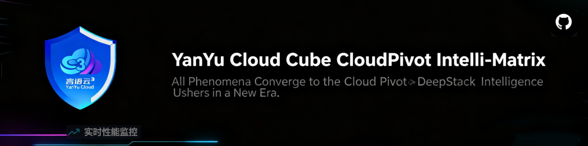

<div align="center">



# YYC³ CloudPivot Intelli-Matrix

**言启象限 · 语枢未来 | 四端一核 · 十二包同源 · 全链路质量门禁**

`一码四形态` `Monorepo` `React 19` `TypeScript strict` `Vite 8` `pnpm workspace` `shadcn/ui + Radix`

<!-- ━━ ① 实时状态（GitHub Actions 直出 · push 自动刷新）━━ -->
[](https://github.com/YYC-Cube/YYC3-DeepStack-Matrix/actions/workflows/ci.yml)
[](https://github.com/YYC-Cube/YYC3-DeepStack-Matrix/actions/workflows/release.yml)

<!-- ━━ ② 质量门禁基线（本地 gates 实证快照）━━ -->
[](scripts/verify-gates.sh)
[](scripts/verify-gates.sh)
[](scripts/reuse-report.mjs)
[](scripts/i18n-bare-key-scan.mjs)
[](docs/YYC3-组件拆分-指导文档/)

<!-- ━━ ③ 技术栈 ━━ -->


<!-- ━━ ④ 工程与安全 ━━ -->


[](https://github.com/YYC-Cube/YYC3-DeepStack-Matrix/security/code-scanning)
[](.github/workflows/ci.yml)
[](LICENSE)
[](https://github.com/YYC-Cube/YYC3-DeepStack-Matrix/pulls)

</div>

---

> **Words Initiate Quadrants, Language Serves as Core for the Future**
> **万象归元于云枢 · 深栈智启新纪元**

**YYC³ CloudPivot Intelli-Matrix** 是「YYC³ Family 本地闭环多端推理矩阵数据看盘系统」——由四个同源历史项目（P1 结构范式 / P2 沙箱韧性 / P3 工程门禁 / P4 功能纵深）经统一拆分收敛而成的 **pnpm Monorepo**：四端应用共享 **@yyc3/* 十二包**，覆盖 AI Family 智能体矩阵、监控中心、运维管理、智慧酒店、通讯基站、IDE 开发工具等八大业务域。工作区目录名 **YYC3-DeepStack-Matrix（深栈矩阵）**——出处「深栈智启新纪元」：十二包深栈能力层托举四端。

---

## 目录

1. [快速开始](#一快速开始)
2. [仓库拓扑：四端 + 十二包](#二仓库拓扑四端--十二包)
3. [图文可视化体系设计](#三图文可视化体系设计)
4. [质量门禁体系](#四质量门禁体系)
5. [开发者工作流](#五开发者工作流)
6. [文档体系索引](#六文档体系索引)

---

## 一、快速开始

```bash
# 环境要求：Node ≥ 22 / pnpm ≥ 10（packageManager 锁 12.11.2）/ Python 3（可选：视觉比对脚本）
pnpm install                 # 安装（workspace 全量）

# 四端并行开发（端口纪律：3030 起，占用即上移）
pnpm --filter @yyc3/app-web-full dev       # P1 完整版   → http://localhost:3030
pnpm --filter @yyc3/app-sandbox-lite dev   # P2 沙箱版   → http://localhost:3031
pnpm --filter @yyc3/app-desktop dev        # P3 桌面版   → http://localhost:3032（Electron: electron:dev）
pnpm --filter @yyc3/app-web-classic dev    # P4 经典版   → http://localhost:3033

# 一键质量门禁（提交前必过）
pnpm gates                  # 全量六阶段（含四端 build）
pnpm gates:quick            # 快速四阶段（跳 build）

# 测试
pnpm --filter @yyc3/app-web-full test -- --run
```

> **认证进入**：未登录访问任意路由会重定向 Login；点击 **GHOST MODE** 可全权进入（开发/演示态）。

---

## 二、仓库拓扑：四端 + 十二包

```text
YYC3-DeepStack-Matrix/
├── apps/                          # 四端应用（同源四形态）
│   ├── app-web-full/              # P1 完整版 —— 结构最规范（modules 域组织 + 首页时钟环）
│   ├── app-sandbox-lite/          # P2 沙箱版 —— Figma Make 特化（React 18 独立演进）
│   ├── app-desktop/               # P3 桌面版 —— Electron + 工程化最强（CI/Docker 遗产源）
│   └── app-web-classic/           # P4 经典版 —— 功能纵深（8 角色 Agent 全集）
│
├── packages/                      # @yyc3/* 十二包（源码直编：exports → src/*.ts）
│   ├── theme/    → 主题令牌单源（8 域主题）
│   ├── ui/       → 49 件 shadcn/Radix 同源组件（GlassCard/YYC3Logo 品牌）
│   ├── core/     → 引擎层（db-adapter 注册表 + database 引擎 + i18n + hooks + types 1714L）
│   ├── store/    → zustand 状态域（slices + offline）
│   ├── ai/       → AI 域组件（4 组件）
│   ├── monitor/  → 监控中心（21 组件）
│   ├── ops/      → 运维管理（20 组件 + full-backup）
│   ├── admin/    → 系统管理（16 组件）
│   ├── business/ → 业务引擎（hotel-engines + comm-station）
│   ├── ai-family/→ AI Family 特深域（87 件：组件+slices+hotel-bridge+HotelDashboard）
│   ├── ide/      → IDE 开发工具（39 件：CodeEditor/theme-presets/ArchitectureAudit）
│   └── shell/    → 壳层（Layout/Sidebar/CommandPalette + NavRegistry 单源）
│
├── scripts/                       # 质量门禁工具链
│   ├── verify-gates.sh            # G1-G6 六阶段一键门禁
│   ├── mock-audit.mjs             # 失效 vi.mock 扫描（STALE=0）
│   ├── i18n-bare-key-scan.mjs     # i18n 裸键扫描（字符级 lexer 解析语言包）
│   └── reuse-report.mjs           # 复用率双口径报表（import / 域组件承接率）
│
├── .github/workflows/
│   ├── ci.yml                     # push/PR：gates + SAST(CodeQL) + Lighthouse(≥0.9)
│   └── release.yml                # tag v*：Electron 三平台 matrix + Docker GHCR
│
├── public/                        # 静态资产 + 视觉基线截图归档
└── docs/                          # 指导文档体系（见 §六）
```

**系统架构总览（ASCII · 分层全景）**：

```text
╔══════════════════════════════════════════════════════════════════════════════╗
║  质量门禁环绕层   pnpm gates → G1 十二包tsc / G2 四端tsc / G3 四端build      ║
║  （verify-gates.sh） G4 vi.mock / G5 i18n裸键 / G6 复用率83.5%               ║
║                   ci.yml: gates+SAST+Lighthouse≥0.9 ⇢ release.yml: tag v*    ║
╠══════════════════════════════════════════════════════════════════════════════╣
║  四端应用层 apps/          （hash 路由 + GHOST MODE 认证门禁）               ║
║  ┌──────────────┬──────────────┬──────────────┬──────────────┐               ║
║  │ app-web-full │app-sandbox-  │ app-desktop  │app-web-      │               ║
║  │ P1 完整版    │lite P2 沙箱  │ P3 桌面版    │classic P4    │               ║
║  │ :3030        │React18 独立  │Electron      │经典版 :3033  │               ║
║  │ 首页时钟环   │壳层留端      │:3032         │功能纵深      │               ║
║  └──────┬───────┴──────┬───────┴──────┬───────┴──────┬───────┘               ║
║         └──────────────┴──────┬───────┴──────────────┘                       ║
║                                ▼  workspace:* 源码直编                       ║
╠══════════════════════════════════════════════════════════════════════════════╣
║  壳层 @yyc3/shell（13 件）  Layout/Sidebar/TopBar/BottomNav/CommandPalette⌘K ║
║                            Login/ErrorBoundary + NavRegistry 导航单源        ║
╠══════════════════════════════════════════════════════════════════════════════╣
║  业务域包层（七大域 · 八大导航全覆盖）                                       ║
║  ┌─────────────┬─────────────┬─────────────┬─────────────────────────┐       ║
║  │ ai-family   │ monitor     │ ops         │ admin                   │       ║
║  │ 87 件特深域 │ 监控 21 组件│ 运维 20 组件│ 系统 16 组件             │      ║
║  │ +HotelDash  │ +AISuggest  │ +full-backup│                         │       ║
║  ├─────────────┼─────────────┴─────────────┼─────────────────────────┤       ║
║  │ business    │ ai（AI 域 4 组件）         │ ide                    │       ║
║  │ hotel引擎   │                           │ 39 件 CodeEditor       │        ║
║  │ +comm基站   │                           │ +ArchitectureAudit     │        ║
║  └──────┬──────┴────────────┬──────────────┴───────────┬─────────────┘       ║
║         │        ai-family→business 单向（防环）        │                    ║
║         ▼                                            ▼                       ║
╠══════════════════════════════════════════════════════════════════════════════╣
║  状态层 @yyc3/store   zustand slices + offline + useOfflineMode              ║
╠══════════════════════════════════════════════════════════════════════════════╣
║  引擎层 @yyc3/core    types 单源 1714L（24 纯桥翻正）· i18n zh+en 双契约     ║
║                      db-adapter 注册表 · database 引擎 9 件 · hooks · CRDT   ║
╠══════════════════════════════════════════════════════════════════════════════╣
║  基础层 @yyc3/ui      49 件 shadcn/Radix 同源（GlassCard/YYC3Logo 品牌）     ║
║         @yyc3/theme   主题令牌单源（8 域主题）                               ║
╚══════════════════════════════════════════════════════════════════════════════╝
        │                                       │
        ▼                                       ▼
┌─────────────────────┐              ┌────────────────────────────┐
│ 视觉资产（L3/L4）    │              │ 发布管线（release.yml）      │
│ visual-baseline 61张 │              │ Electron 三平台 matrix      │
│ toHaveScreenshot 参照│              │ Docker GHCR（monorepo 化）  │
│ 历史截图 69 张 before │              │ gates 前置 → notify 汇总   │
└─────────────────────┘              └────────────────────────────┘
```

> 依赖方向自上而下严格单向（无环）：apps → shell → 业务域 → store → core → ui/theme；
> 类型唯一真源在 core/types，端侧 24 分件已翻正为纯 re-export 桥。

---

## 三、图文可视化体系设计

本项目文档体系采用**四层图文资产**，各层职责与引用规范如下：

| 层级 | 资产 | 规格 | 引用位置 | 职责 |
| ---- | ---- | ---- | ---- | ---- |
| **L1 品牌层** | `public/yyc3-matrix.png` | **1729×432 原尺寸** | 文档**顶图**（本文档顶部） | 品牌识别：Matrix 主视觉横幅，定义文档基调 |
| **L2 主题层** | `public/yyc3-family.png` | **1800×450 原尺寸** | 文档**中图**（本节下方） | 情感叙事：AI Family 主题，承接业务域介绍 |
| **L3 基线层** | `docs/.../phase6-ledger/visual-baseline/` | 61 张（p1/p2/p3/p4 × manifest） | 视觉快照台账 | 回归基准：`toHaveScreenshot`（maxDiff 0.5%）比对参照 |
| **L4 历史层** | `public/YYC3-Matrix-项目截图-导航分类/` | 69 张（8 大导航归档） | 拆分指导文档 | Before 锚点：迁移前视觉证据（源码+截图双证互证） |

<div align="center">


*AI Family 智能体矩阵 —— 十二包中体量最大的特深域（@yyc3/ai-family 87 件）*

</div>

### 图文规范

- **顶图/中图**：`` 显式标注原尺寸 width（GitHub 渲染自动适配，原图点击可放大）；仅根级主文档使用，子文档不重复
- **架构图**：一律 ASCII 内联（` ```text ` 代码块）——随代码演进零维护成本，禁止外链图片画架构
- **截图资产**：入库 `public/` 或 `docs/**/`，配 `manifest.json` 元数据（路由/字节/body 长度/404 标记）
- **可视化比对**：像素级 diff 用 Pillow ImageChops（灰度 >30 灰阶阈值，<0.5% PASS）；a11y 用本地 `axe-core` 注入扫描
- **状态图标**：✅ 达成 / ◐ 部分 / ⬜ 未开始 / ⚠️ 存量登记 / ❌ 阻断

---

## 四、质量门禁体系

### 本地六阶段（`pnpm gates`）

| 阶段 | 门禁 | 当前状态 |
| ---- | ---- | ---- |
| G1 | 十二包 tsc 全 0 | ✅ |
| G2 | 四端 tsc 全 0 | ✅ |
| G3 | 四端 build 全绿 | ✅ |
| G4 | 失效 vi.mock 扫描 STALE=0 | ✅ |
| G5 | i18n 裸键扫描（三端+十一包，1220 keys） | ✅ 归零 |
| G6 | 复用率双口径报表 | ✅ 三端净 **83.5%**（DoD ≥80%） |

### CI/CD（GitHub Actions）

- **push/PR** → `ci.yml`：gates + vitest 分片 + SAST（CodeQL）+ Lighthouse（performance ≥0.9，本地实测 **0.94**）
- **tag v\*** → `release.yml`：发布必过质量关 → Electron 三平台 matrix（mac dmg / win nsis / linux AppImage+deb）+ Docker GHCR（monorepo 化 Dockerfile）→ 产物 artifact 上传 + 通知汇总

### 核心纪律

- **验证矩阵**：任何改动后十二包 + 四端 tsc=0 保持（`pnpm gates:quick` 一键）
- **端口纪律**：3030 起，被占用即上移（不 kill 外部进程）
- **不盲猜**：类型补录必须从真源文件取定义；遗产配置（CI/构建/overrides）必须本地首跑实证
- **偏差编号登记**：所有执行偏差沉淀至对应 phase ledger

---

## 五、开发者工作流

```text
新特性/修复
  │
  ├─ 1. 定位归属：业务域组件 → 对应 @yyc3 包；端侧仅壳/路由/config 绑定
  │
  ├─ 2. 开发：packages/*/src 直编（无需包构建）；app 消费走 workspace:*
  │        新组件 → 补包 exports 子路径 + barrel
  │
  ├─ 3. 类型：类型定义入 @yyc3/core/types（单源）；端侧 types/*.ts 已翻正为纯桥
  │        i18n 新键 → zh-CN.ts + en-US.ts 双补（DeepStringify 契约 tsc 把关）
  │
  ├─ 4. 验证：pnpm gates:quick（六阶段）+ 相关域 vitest 抽测
  │
  ├─ 5. 文档：跨阶段结论同步 docs/ 对应执行日志 + 主文档版本号
  │
  └─ 6. 提交：git 本地提交（信息含验证矩阵摘要）；发布日打 tag v* 触发 release.yml
```

### 关键约定

| 项 | 约定 |
| ---- | ---- |
| 包消费 | `import { X } from "@yyc3/<pkg>"` 或子路径 `"@yyc3/<pkg>/<kebab-file>"` |
| 新包组件 | `packages/<pkg>/src/Foo.tsx` + exports 加 `"./foo": "./src/Foo.tsx"` + index barrel |
| 类型 | 唯一真源 `@yyc3/core/types`；分件只做 `export type {...} from` 桥 |
| 环境声明 | d.ts 环境声明必须独立非模块文件（无顶层 import，否则降级为模块增强失效） |
| Electron 打包 | `CSC_IDENTITY_AUTO_DISCOVERY=false` + `electron-builder --mac --dir --publish never` |
| 视觉回归 | 改 UI 后重采四端截图 vs `visual-baseline/`（阈值 0.5%） |

---

## 六、文档体系索引

```text
docs/YYC3-组件拆分-指导文档/
├── YYC3-四项目实况对比-统一拆分实施流程.md   # 主文档（v1.22）：四项目审计 + Phase 0-6 全程实录
├── YYC3-Phase6-执行日志.md                   # Phase 6 持续发布执行日志
├── phase0-ledger ~ phase6-ledger/            # 各阶段台账（视觉/a11y/包化/偏差登记）
│   └── phase6-ledger/visual-baseline/        # ★ 四端 61 张视觉基线 + manifest
└── （方法论 6 份 + 各 Phase 执行日志）
```

| 想了解 | 看 |
| ---- | ---- |
| 项目从哪来（四项目同源审计） | 主文档 §0-2 |
| 架构与包拓扑怎么定型的 | 主文档 Phase 2-5 + 各 phase ledger |
| 质量门禁怎么用 | 本文 §四 + `scripts/verify-gates.sh` 头注释 |
| 视觉基线怎么比对 | `phase6-ledger/03/04` 台账 |
| 每一步的坑与教训 | 各 Phase 执行日志「关键实证」+ 偏差编号 |

---

<div align="center">

**© 2025-2026 YanYuCloudCube™. All Rights Reserved.**

「***YanYuCloudCube***」 · 「***<admin@0379.email>***」

*All things converge in cloud pivot; Deep stacks ignite a new era of intelligence*

</div>
