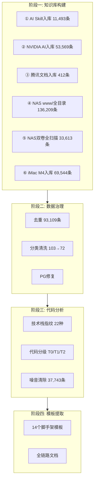

# YYC³ CloudCube KB - 导师执导全链路操作手册

> 版本: v1.0.0
> 日期: 2026-04-26
> 执行者: GLM 导师 (YYC³ AI Family)
> 目标: 从零构建知识库 → 代码清洗 → 脚手架模板 → 全链路闭环

---

## 一、阶段执行总览



---

## 二、最终数据成果

| 指标 | 数值 |
|------|------|
| 最终记录数 | **174,088** |
| 原始入库 | 308,262 |
| 去重删除 | 93,109 (内容去重) |
| 噪音清除 | 37,743 (T0噪音) |
| 技术栈标签 | 22种 |
| 代码分级 | T1: 30,286 / T2: 143,802 |
| 分类数 | 72个精准分类 |
| 数据库大小 | 830 MB |
| 脚手架模板 | 14个文件 |
| 全链路文档 | 3份 |

---

## 三、脚本清单与执行说明

### 3.1 入库脚本

| 脚本 | 用途 | 执行位置 | 参数 |
|------|------|----------|------|
| kb-ingest.py | AI Skill知识入库 | NAS本地 | DB_HOST=127.0.0.1 |
| kb-ingest-nvidia.py | NVIDIA AI知识入库 | NAS本地 | DB_HOST=127.0.0.1 |
| kb-ingest-docs.py | 文档(PDF/DOCX/XLSX)入库 | NAS本地 | DB_HOST=127.0.0.1 |
| kb-ingest-www.py | www/全目录入库 | NAS本地 | DB_HOST=127.0.0.1 |
| kb-ingest-nas-full.py | NAS双卷全扫描入库 | NAS本地 | DB_HOST=127.0.0.1 |
| kb-ingest-imac77.py | iMac M4项目入库 | iMac本地 | DB_HOST=192.168.3.45 |

### 3.2 治理脚本

| 脚本 | 用途 | 执行位置 |
|------|------|----------|
| kb-cleanup.py | 去重+重分类 | NAS本地 |
| kb-cleanup-categories.sql | 分类清洗SQL | 任意psql客户端 |
| kb-tag-techstack.py | 技术栈指纹+代码分级 | 任意psql客户端 |

### 3.3 模板提取脚本

| 脚本 | 用途 | 执行位置 |
|------|------|----------|
| kb-extract-templates.py | 从KB提取最优模板 | 任意psql客户端 |

---

## 四、执行命令速查

### 4.1 入库命令

```bash
# NAS本地入库 (零网络传输)
scp -P 9557 scripts/kb-ingest-xxx.py yyc3-45:/tmp/
ssh -p 9557 yyc3-45 "python3 /tmp/kb-ingest-xxx.py"

# iMac入库 (网络写入NAS DB)
scp scripts/kb-ingest-imac77.py my@192.168.3.77:/tmp/
ssh my@192.168.3.77 "python3 /tmp/kb-ingest-imac77.py"
```

### 4.2 治理命令

```bash
# 技术栈标记
python3 scripts/kb-tag-techstack.py

# 分类清洗
psql -h 192.168.3.45 -U postgres -d yyc3_kb -f scripts/kb-cleanup-categories.sql

# T0噪音清除
psql -h 192.168.3.45 -U postgres -d yyc3_kb -c "DELETE FROM kb_entries WHERE code_tier = 'T0';"
```

### 4.3 模板提取命令

```bash
python3 scripts/kb-extract-templates.py
# 输出到 yyc3-template/ 目录
```

### 4.4 查询命令

```bash
# 连接知识库
psql -h 192.168.3.45 -p 5432 -U postgres -d yyc3_kb

# 技术栈分布
SELECT tech_stack, count(*) FROM kb_entries GROUP BY tech_stack ORDER BY count(*) DESC;

# 代码分级分布
SELECT code_tier, count(*) FROM kb_entries GROUP BY code_tier;

# 按技术栈+分级交叉查询
SELECT tech_stack, code_tier, count(*) FROM kb_entries GROUP BY tech_stack, code_tier ORDER BY count(*) DESC;

# 搜索核心代码
SELECT title, category, content_summary FROM kb_entries WHERE code_tier='T2' AND content ILIKE '%agent%' LIMIT 20;
```

---

## 五、数据库表结构

```sql
CREATE TABLE kb_entries (
    id              serial PRIMARY KEY,
    source_path     text NOT NULL,
    source_type     varchar(50) NOT NULL,
    title           text,
    content         text NOT NULL,
    content_summary text,
    embedding       vector(1024),
    tags            text[],
    category        varchar(100),
    skill_name      varchar(200),
    metadata        jsonb DEFAULT '{}'::jsonb,
    content_hash    text,
    tech_stack      varchar(50),
    code_tier       char(2),
    created_at      timestamptz DEFAULT now(),
    updated_at      timestamptz DEFAULT now()
);

-- 索引
CREATE INDEX idx_kb_category ON kb_entries(category);
CREATE INDEX idx_kb_skill ON kb_entries(skill_name);
CREATE INDEX idx_kb_source ON kb_entries(source_path);
CREATE INDEX idx_kb_type ON kb_entries(source_type);
CREATE INDEX idx_kb_content_hash ON kb_entries(content_hash);
CREATE INDEX idx_kb_tech_stack ON kb_entries(tech_stack);
CREATE INDEX idx_kb_code_tier ON kb_entries(code_tier);
```

---

## 六、NAS环境信息

| 项目 | 值 |
|------|-----|
| 设备 | TNAS F4-423 |
| SSH | ssh -p 9557 yyc3-45 |
| PostgreSQL | 14.15, 端口5432, 用户postgres |
| pgvector | 0.6.2 (向量检索扩展) |
| 数据库 | yyc3_kb |
| 存储路径 | /Volume1/www, /Volume2/yyc3_sd |

---

## 七、本阶段文件清单

```
GLM-导师执导/
├── docs/
│   ├── CloudCube-KB-Architecture.md        知识库架构文档v3.0
│   ├── CloudCube-CodePipeline.md           代码全链路闭环技术分析
│   └── GLM-导师执导-操作手册.md              本文件
├── scripts/
│   ├── kb-ingest.py                        AI Skill入库
│   ├── kb-ingest-nvidia.py                 NVIDIA知识入库
│   ├── kb-ingest-docs.py                   文档入库
│   ├── kb-ingest-www.py                    www/全目录入库
│   ├── kb-ingest-nas-full.py               NAS双卷全扫描
│   ├── kb-ingest-imac77.py                 iMac M4入库
│   ├── kb-cleanup.py                       去重+重分类
│   ├── kb-cleanup-categories.sql           分类清洗SQL
│   ├── kb-tag-techstack.py                 技术栈指纹标记
│   └── kb-extract-templates.py             模板提取
└── templates/
    ├── app/
    │   ├── layout.tsx                      全局布局模板
    │   ├── page.tsx                        页面模板
    │   ├── loading.tsx                     加载态模板
    │   ├── error.tsx                       错误页模板
    │   ├── not-found.tsx                   404模板
    │   └── api/route.ts                    API路由模板
    ├── lib/utils.ts                        工具函数模板
    ├── middleware.ts                       中间件模板
    ├── tailwind.config.ts                  Tailwind配置
    ├── next.config.ts                      Next.js配置
    ├── docker-compose.yml                  Docker编排
    ├── Dockerfile                          多阶段构建
    ├── env.example                         环境变量
    └── .github/workflows/ci.yml            CI/CD流水线
```

---

## 八、变更日志

### v1.0.0 (2026-04-26)
- 完成全链路闭环: 入库→去重→分类→技术栈标记→噪音清除→模板提取
- 6批次入库 308,262条 → 去重+清洗 → 174,088条
- 22种技术栈指纹标记
- T0/T1/T2代码分级
- 14个脚手架模板提取
- 3份完整文档
- 全部脚本+模板+文档保存至NAS
