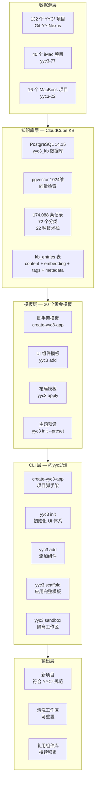
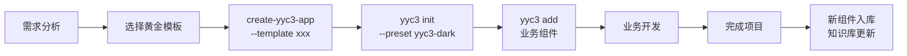

# YYC³ UI/UX 复用体系与知识库衔接 — 教科书级指导文档

> 版本: v1.0.0
> 日期: 2026-05-04
> 技术栈: Next.js 15 + React 19 + shadcn/ui + Radix UI + Tailwind CSS 4 + pnpm
> 知识库: CloudCube KB — 174,088 条代码资产 (PostgreSQL 14.15 + pgvector 0.6.2)
> CLI: @yyc3/cli v1.0.0 (create-yyc3-app / yyc3 init / yyc3 add)

---

## 第一章：体系总览

### 1.1 核心理念

```
132 个项目 → 1235 组重复 → 症结: 手动复制
                    ↓
          20 个黄金模板 → 标准化复用
                    ↓
     知识库 174,088 条 → 智能检索匹配
                    ↓
        @yyc3/cli → 一条命令生成
```

**不再手动复制项目**：一条命令即可获得任意模板。
**模板即代码**：所有模板存储在 Git 中，可版本化、可 diff。
**彻底隔离工作区**：清洗专用目录随时可重置，不污染原始项目。
**知识库衔接**：174,088 条代码资产提供向量检索，为模板选取和组件推荐提供智能支撑。

### 1.2 全链路架构



---

## 第二章：20 个黄金模板选取与标记

### 2.1 选取原则

从 132 个项目中精选 20 个作为"黄金模板"，选取标准：

| 维度 | 权重 | 说明 |
|------|------|------|
| **代码量** | 20% | 代码行数 > 5,000，说明业务场景完整 |
| **UI 复杂度** | 25% | 使用 Radix UI + shadcn/ui，组件丰富 |
| **健康度** | 20% | 有 README、Dockerfile、CI/CD、.env.example |
| **独立性** | 15% | 不依赖其他项目，可独立运行 |
| **代表性** | 20% | 覆盖不同业务场景（AI/医疗/教育/管理/仪表盘） |

### 2.2 20 个黄金模板清单

以下是从 132 个项目中，按场景分类精选的 20 个黄金模板：

#### A 类：AI 应用 (4 个)

| # | 模板ID | 源项目 | 场景 | 代码行 | 端口 | 标记标签 |
|---|--------|--------|------|--------|------|----------|
| 1 | `tpl-ai-chat` | yyc3-ai-llm-ai | AI对话+模型管理 | 34,548 | 3300 | `ai,chat,llm,radix,pnpm,app-router` |
| 2 | `tpl-ai-deepstack` | yyc3-ai-application-yanyu-cloud-deepstack | AI全栈+Python后端 | 32,735 | 3301 | `ai,deepstack,python,radix,pnpm,app-router` |
| 3 | `tpl-ai-business` | yyc3-ai-application-intelligent-business-center | AI商业智能中心 | 98,762 | 3302 | `ai,business,enterprise,radix,pnpm,app-router` |
| 4 | `tpl-ai-robotics` | yyc3-tools-devtemplate-ai-robotics-landing-page | AI产品着陆页 | 609 | 3303 | `ai,landing,robotics,radix,pnpm,app-router` |

#### B 类：仪表盘 (3 个)

| # | 模板ID | 源项目 | 场景 | 代码行 | 端口 | 标记标签 |
|---|--------|--------|------|--------|------|----------|
| 5 | `tpl-dash-futuristic` | yyc3-platform-cloud-futuristic-dashboard-3 | 未来感仪表盘 | 10,758 | 3201 | `dashboard,futuristic,3d,radix,pnpm,app-router` |
| 6 | `tpl-dash-data` | yyc3-platform-cloud-dashboard-3 | 数据仪表盘 | 77,614 | 3202 | `dashboard,data,charts,radix,pnpm,app-router` |
| 7 | `tpl-dash-admin` | yyc3-platform-management-admin-system-3 | 管理后台系统 | 124,177 | 3203 | `dashboard,admin,rbac,radix,npm,app-router` |

#### C 类：医疗 (2 个)

| # | 模板ID | 源项目 | 场景 | 代码行 | 端口 | 标记标签 |
|---|--------|--------|------|--------|------|----------|
| 8 | `tpl-med-full` | yyc3-other-medical | 完整医疗系统 | 135,008 | 3210 | `medical,full-system,radix,npm,app-router` |
| 9 | `tpl-med-nexus` | yyc3-platform-cloud-medinexus | 医疗知识图谱 | 166,006 | 3211 | `medical,knowledge-graph,radix,pnpm,app-router` |

#### D 类：教育 (2 个)

| # | 模板ID | 源项目 | 场景 | 代码行 | 端口 | 标记标签 |
|---|--------|--------|------|--------|------|----------|
| 10 | `tpl-edu-hub` | yyc3-edu-learning-hub | 学习平台 | 22,468 | 3220 | `education,learning,lms,radix,pnpm,app-router` |
| 11 | `tpl-edu-platform` | yyc3-ai-application-learning-platform | AI教育平台 | 18,848 | 3221 | `education,ai-learning,radix,pnpm,app-router` |

#### E 类：管理平台 (3 个)

| # | 模板ID | 源项目 | 场景 | 代码行 | 端口 | 标记标签 |
|---|--------|--------|------|--------|------|----------|
| 12 | `tpl-mgmt-platform` | yyc3-ai-platform-management | 组件库管理平台 | 95,752 | 3230 | `management,components,radix,pnpm,app-router` |
| 13 | `tpl-mgmt-city` | yyc3-platform-management-smart-city-platform | 智慧城市 | 12,416 | 3231 | `management,smart-city,iot,pnpm,app-router` |
| 14 | `tpl-mgmt-customer` | yyc3-office-customer-care-center | 客户服务中心 | 34,072 | 3232 | `management,crm,customer,radix,pnpm,app-router` |

#### F 类：组件库/工具 (3 个)

| # | 模板ID | 源项目 | 场景 | 代码行 | 端口 | 标记标签 |
|---|--------|--------|------|--------|------|----------|
| 15 | `tpl-comp-library` | yyc3-ai-platform-lan | UI组件库展示 | 34,001 | 3240 | `component-library,showcase,radix,pnpm,app-router` |
| 16 | `tpl-tool-docker` | yyc3-tools-env-docker-stack | Docker部署栈 | 40,783 | 3241 | `tools,docker,devops,radix,pnpm,app-router` |
| 17 | `tpl-tool-table` | yyc3-tools-easy-table-converter | 表格转换工具 | 11,103 | 3242 | `tools,table,converter,radix,pnpm,app-router` |

#### G 类：着陆页/SaaS (3 个)

| # | 模板ID | 源项目 | 场景 | 代码行 | 端口 | 标记标签 |
|---|--------|--------|------|--------|------|----------|
| 18 | `tpl-landing-brand` | yyc3-ai-application-landing-page | 品牌着陆页 | 3,251 | 3200 | `landing,brand,spline,radix,pnpm,app-router` |
| 19 | `tpl-saas` | yyc3-platform-cloud-saas-3 | SaaS平台 | 2,080 | 3243 | `saas,multi-tenant,radix,pnpm,app-router` |
| 20 | `tpl-api-service` | yyc3-platform-cloud-mdy-api | API服务 | 24,189 | 3400 | `api,rest,auth,radix,pnpm,app-router` |

### 2.3 标记体系设计

每个黄金模板在知识库中使用以下标记字段：

```sql
-- 知识库中标记黄金模板的 SQL
-- metadata 字段扩展

UPDATE kb_entries SET metadata = metadata || jsonb_build_object(
    'golden_template', true,
    'template_id', 'tpl-ai-chat',
    'template_category', 'ai',
    'template_tags', ARRAY['ai','chat','llm','radix','pnpm','app-router'],
    'template_port', 3300,
    'template_rank', 1,
    'template_source', 'yyc3-ai-llm-ai',
    'ui_framework', 'shadcn/ui + Radix UI',
    'ux_pattern', 'chat-panel + model-selector + tool-invocation',
    'layout_type', 'sidebar-main',
    'theme_presets', ARRAY['yyc3-dark','yyc3-light','yyc3-brand','nova']
) WHERE source_path LIKE '%yyc3-ai-llm-ai%'
  AND code_tier IN ('T1', 'T2');
```

#### 标记字段说明

| 字段 | 类型 | 说明 | 示例 |
|------|------|------|------|
| `golden_template` | boolean | 是否为黄金模板 | `true` |
| `template_id` | string | 唯一模板标识 | `tpl-ai-chat` |
| `template_category` | string | 业务分类 | `ai` / `dashboard` / `medical` |
| `template_tags` | text[] | 技术标签数组 | `['ai','chat','radix','pnpm']` |
| `template_port` | int | 默认开发端口 | `3300` |
| `template_rank` | int | 推荐排序权重 (1=最高) | `1` |
| `template_source` | string | 源项目名 | `yyc3-ai-llm-ai` |
| `ui_framework` | string | UI框架 | `shadcn/ui + Radix UI` |
| `ux_pattern` | string | UX交互模式 | `chat-panel + model-selector` |
| `layout_type` | string | 布局类型 | `sidebar-main` / `top-nav` / `full-page` |
| `theme_presets` | text[] | 支持的主题预设 | `['yyc3-dark','yyc3-light']` |

### 2.4 批量标记脚本

```sql
-- batch-tag-golden-templates.sql
-- 一次性标记全部 20 个黄金模板

-- A 类: AI 应用
UPDATE kb_entries SET metadata = metadata || jsonb_build_object(
    'golden_template', true, 'template_id', 'tpl-ai-chat',
    'template_category', 'ai', 'template_rank', 1,
    'template_port', 3300, 'layout_type', 'sidebar-main',
    'ui_framework', 'shadcn/ui + Radix UI',
    'ux_pattern', 'chat-panel + model-selector + tool-invocation',
    'theme_presets', ARRAY['yyc3-dark','yyc3-light','yyc3-brand','nova']
) WHERE source_path LIKE '%yyc3-ai-llm-ai%' AND code_tier IN ('T1','T2');

UPDATE kb_entries SET metadata = metadata || jsonb_build_object(
    'golden_template', true, 'template_id', 'tpl-ai-deepstack',
    'template_category', 'ai', 'template_rank', 2,
    'template_port', 3301, 'layout_type', 'sidebar-main',
    'ui_framework', 'shadcn/ui + Radix UI',
    'ux_pattern', 'multi-panel + code-editor + terminal'
) WHERE source_path LIKE '%yyc3-ai-application-yanyu-cloud-deepstack%' AND code_tier IN ('T1','T2');

UPDATE kb_entries SET metadata = metadata || jsonb_build_object(
    'golden_template', true, 'template_id', 'tpl-ai-business',
    'template_category', 'ai', 'template_rank', 3,
    'template_port', 3302, 'layout_type', 'sidebar-main',
    'ui_framework', 'shadcn/ui + Radix UI',
    'ux_pattern', 'dashboard + data-table + workflow'
) WHERE source_path LIKE '%yyc3-ai-application-intelligent-business-center%' AND code_tier IN ('T1','T2');

UPDATE kb_entries SET metadata = metadata || jsonb_build_object(
    'golden_template', true, 'template_id', 'tpl-ai-robotics',
    'template_category', 'ai', 'template_rank', 4,
    'template_port', 3303, 'layout_type', 'full-page',
    'ui_framework', 'shadcn/ui + Radix UI',
    'ux_pattern', 'hero-section + feature-grid + cta'
) WHERE source_path LIKE '%yyc3-tools-devtemplate-ai-robotics-landing-page%' AND code_tier IN ('T1','T2');

-- B 类: 仪表盘
UPDATE kb_entries SET metadata = metadata || jsonb_build_object(
    'golden_template', true, 'template_id', 'tpl-dash-futuristic',
    'template_category', 'dashboard', 'template_rank', 5,
    'template_port', 3201, 'layout_type', 'sidebar-main',
    'ui_framework', 'shadcn/ui + Radix UI',
    'ux_pattern', '3d-background + glass-card + animated-charts'
) WHERE source_path LIKE '%yyc3-platform-cloud-futuristic-dashboard-3%' AND code_tier IN ('T1','T2');

UPDATE kb_entries SET metadata = metadata || jsonb_build_object(
    'golden_template', true, 'template_id', 'tpl-dash-data',
    'template_category', 'dashboard', 'template_rank', 6,
    'template_port', 3202, 'layout_type', 'sidebar-main',
    'ui_framework', 'shadcn/ui + Radix UI',
    'ux_pattern', 'data-table + filter-bar + chart-grid + detail-drawer'
) WHERE source_path LIKE '%yyc3-platform-cloud-dashboard-3%' AND code_tier IN ('T1','T2');

UPDATE kb_entries SET metadata = metadata || jsonb_build_object(
    'golden_template', true, 'template_id', 'tpl-dash-admin',
    'template_category', 'dashboard', 'template_rank', 7,
    'template_port', 3203, 'layout_type', 'sidebar-main',
    'ui_framework', 'shadcn/ui + Radix UI',
    'ux_pattern', 'rbac-menu + crud-table + form-modal + audit-log'
) WHERE source_path LIKE '%yyc3-platform-management-admin-system-3%' AND code_tier IN ('T1','T2');

-- C 类: 医疗
UPDATE kb_entries SET metadata = metadata || jsonb_build_object(
    'golden_template', true, 'template_id', 'tpl-med-full',
    'template_category', 'medical', 'template_rank', 8,
    'template_port', 3210, 'layout_type', 'sidebar-main',
    'ui_framework', 'shadcn/ui + Radix UI',
    'ux_pattern', 'patient-list + detail-card + timeline + prescription'
) WHERE source_path LIKE '%yyc3-other-medical%' AND code_tier IN ('T1','T2');

UPDATE kb_entries SET metadata = metadata || jsonb_build_object(
    'golden_template', true, 'template_id', 'tpl-med-nexus',
    'template_category', 'medical', 'template_rank', 9,
    'template_port', 3211, 'layout_type', 'sidebar-main',
    'ui_framework', 'shadcn/ui + Radix UI',
    'ux_pattern', 'knowledge-graph + search + entity-panel'
) WHERE source_path LIKE '%yyc3-platform-cloud-medinexus%' AND code_tier IN ('T1','T2');

-- D 类: 教育
UPDATE kb_entries SET metadata = metadata || jsonb_build_object(
    'golden_template', true, 'template_id', 'tpl-edu-hub',
    'template_category', 'education', 'template_rank', 10,
    'template_port', 3220, 'layout_type', 'sidebar-main',
    'ui_framework', 'shadcn/ui + Radix UI',
    'ux_pattern', 'course-grid + video-player + quiz + progress'
) WHERE source_path LIKE '%yyc3-edu-learning-hub%' AND code_tier IN ('T1','T2');

UPDATE kb_entries SET metadata = metadata || jsonb_build_object(
    'golden_template', true, 'template_id', 'tpl-edu-platform',
    'template_category', 'education', 'template_rank', 11,
    'template_port', 3221, 'layout_type', 'sidebar-main',
    'ui_framework', 'shadcn/ui + Radix UI',
    'ux_pattern', 'ai-tutor + learning-path + adaptive-quiz'
) WHERE source_path LIKE '%yyc3-ai-application-learning-platform%' AND code_tier IN ('T1','T2');

-- E 类: 管理平台
UPDATE kb_entries SET metadata = metadata || jsonb_build_object(
    'golden_template', true, 'template_id', 'tpl-mgmt-platform',
    'template_category', 'management', 'template_rank', 12,
    'template_port', 3230, 'layout_type', 'sidebar-main',
    'ui_framework', 'shadcn/ui + Radix UI',
    'ux_pattern', 'component-showcase + playground + docs'
) WHERE source_path LIKE '%yyc3-ai-platform-management%' AND code_tier IN ('T1','T2');

UPDATE kb_entries SET metadata = metadata || jsonb_build_object(
    'golden_template', true, 'template_id', 'tpl-mgmt-city',
    'template_category', 'management', 'template_rank', 13,
    'template_port', 3231, 'layout_type', 'sidebar-main',
    'ui_framework', 'shadcn/ui + Radix UI',
    'ux_pattern', 'map-view + device-list + alert-panel + analytics'
) WHERE source_path LIKE '%yyc3-platform-management-smart-city-platform%' AND code_tier IN ('T1','T2');

UPDATE kb_entries SET metadata = metadata || jsonb_build_object(
    'golden_template', true, 'template_id', 'tpl-mgmt-customer',
    'template_category', 'management', 'template_rank', 14,
    'template_port', 3232, 'layout_type', 'sidebar-main',
    'ui_framework', 'shadcn/ui + Radix UI',
    'ux_pattern', 'ticket-list + chat-widget + customer-profile + sla'
) WHERE source_path LIKE '%yyc3-office-customer-care-center%' AND code_tier IN ('T1','T2');

-- F 类: 组件库/工具
UPDATE kb_entries SET metadata = metadata || jsonb_build_object(
    'golden_template', true, 'template_id', 'tpl-comp-library',
    'template_category', 'component-library', 'template_rank', 15,
    'template_port', 3240, 'layout_type', 'sidebar-main',
    'ui_framework', 'shadcn/ui + Radix UI',
    'ux_pattern', 'catalog + playground + props-table + code-preview'
) WHERE source_path LIKE '%yyc3-ai-platform-lan%' AND code_tier IN ('T1','T2');

UPDATE kb_entries SET metadata = metadata || jsonb_build_object(
    'golden_template', true, 'template_id', 'tpl-tool-docker',
    'template_category', 'tools', 'template_rank', 16,
    'template_port', 3241, 'layout_type', 'sidebar-main',
    'ui_framework', 'shadcn/ui + Radix UI',
    'ux_pattern', 'stack-manager + logs + config-editor'
) WHERE source_path LIKE '%yyc3-tools-env-docker-stack%' AND code_tier IN ('T1','T2');

UPDATE kb_entries SET metadata = metadata || jsonb_build_object(
    'golden_template', true, 'template_id', 'tpl-tool-table',
    'template_category', 'tools', 'template_rank', 17,
    'template_port', 3242, 'layout_type', 'top-nav',
    'ui_framework', 'shadcn/ui + Radix UI',
    'ux_pattern', 'dropzone + preview + conversion + download'
) WHERE source_path LIKE '%yyc3-tools-easy-table-converter%' AND code_tier IN ('T1','T2');

-- G 类: 着陆页/SaaS
UPDATE kb_entries SET metadata = metadata || jsonb_build_object(
    'golden_template', true, 'template_id', 'tpl-landing-brand',
    'template_category', 'landing', 'template_rank', 18,
    'template_port', 3200, 'layout_type', 'full-page',
    'ui_framework', 'shadcn/ui + Radix UI',
    'ux_pattern', 'hero + features + pricing + testimonials + cta'
) WHERE source_path LIKE '%yyc3-ai-application-landing-page%' AND code_tier IN ('T1','T2');

UPDATE kb_entries SET metadata = metadata || jsonb_build_object(
    'golden_template', true, 'template_id', 'tpl-saas',
    'template_category', 'saas', 'template_rank', 19,
    'template_port', 3243, 'layout_type', 'sidebar-main',
    'ui_framework', 'shadcn/ui + Radix UI',
    'ux_pattern', 'tenant-switcher + billing + usage-dashboard + settings'
) WHERE source_path LIKE '%yyc3-platform-cloud-saas-3%' AND code_tier IN ('T1','T2');

UPDATE kb_entries SET metadata = metadata || jsonb_build_object(
    'golden_template', true, 'template_id', 'tpl-api-service',
    'template_category', 'api', 'template_rank', 20,
    'template_port', 3400, 'layout_type', 'sidebar-main',
    'ui_framework', 'shadcn/ui + Radix UI',
    'ux_pattern', 'api-docs + playground + key-manager + logs'
) WHERE source_path LIKE '%yyc3-platform-cloud-mdy-api%' AND code_tier IN ('T1','T2');
```

### 2.5 验证标记结果

```sql
-- 查看已标记的黄金模板
SELECT
    metadata->>'template_id' AS template_id,
    metadata->>'template_category' AS category,
    metadata->>'template_source' AS source,
    metadata->>'layout_type' AS layout,
    count(*) AS kb_entries_count
FROM kb_entries
WHERE metadata->>'golden_template' = 'true'
GROUP BY 1,2,3,4
ORDER BY (metadata->>'template_rank')::int;

-- 预期输出: 20 行，每行对应一个黄金模板
```

---

## 第三章：UI/UX 复用策略

### 3.1 七层复用架构

```
┌─────────────────────────────────────────────────────────────┐
│ 第7层: 部署运维  Dockerfile / CI/CD / Nginx / SSL           │
├─────────────────────────────────────────────────────────────┤
│ 第6层: 错误处理  error-boundary / toast / log / fallback     │
├─────────────────────────────────────────────────────────────┤
│ 第5层: 基础服务  api / auth / db / utils / config            │
├─────────────────────────────────────────────────────────────┤
│ 第4层: UI组件    shadcn/ui / layout / business               │
├─────────────────────────────────────────────────────────────┤
│ 第3层: 路由体系  layout / page / loading / error / api       │
├─────────────────────────────────────────────────────────────┤
│ 第2层: 全局配置  next.config / tailwind / tsconfig / env     │
├─────────────────────────────────────────────────────────────┤
│ 第1层: 项目脚手架  create-yyc3-app                           │
└─────────────────────────────────────────────────────────────┘
```

**复用原则**：第 1~3 层 100% 复用，第 4~5 层按场景选取，第 6~7 层按需定制。

### 3.2 布局类型与 UX 模式映射

| 布局类型 | 适用场景 | 核心组件 | 黄金模板 |
|----------|----------|----------|----------|
| `sidebar-main` | 管理后台、仪表盘、AI平台 | Sidebar + Header + Main + Breadcrumb | tpl-dash-data, tpl-mgmt-platform |
| `top-nav` | 着陆页、营销站、工具 | Navbar + Hero + Sections + Footer | tpl-tool-table, tpl-landing-brand |
| `full-page` | 对话界面、编辑器、演示 | 全屏容器 + 浮动面板 | tpl-ai-chat, tpl-ai-robotics |
| `split-panel` | 对比、双栏编辑器 | 左右分栏 + 可调宽度 | tpl-ai-deepstack |
| `tabbed` | 设置、多步骤流程 | TabList + TabContent + Stepper | tpl-saas |

### 3.3 UI 组件复用矩阵

```
所有 20 个模板共享的组件（100% 复用）:
├── ui/button          ← shadcn/ui 基础组件
├── ui/input           ← 表单输入
├── ui/dialog          ← 弹窗 (Radix Dialog)
├── ui/dropdown-menu   ← 下拉菜单 (Radix DropdownMenu)
├── ui/select          ← 选择器 (Radix Select)
├── ui/table           ← 数据表格
├── ui/toast           ← 提示 (Radix Toast)
├── ui/tabs            ← 标签页 (Radix Tabs)
├── ui/card            ← 卡片容器
├── ui/avatar          ← 头像
├── ui/badge           ← 徽章
├── ui/skeleton        ← 骨架屏
└── ui/tooltip         ← 工具提示

按场景复用的组件:
├── layout/sidebar          ← sidebar-main 布局 (14 个模板)
├── layout/header           ← 顶部导航 (18 个模板)
├── layout/breadcrumb       ← 面包屑 (12 个模板)
├── business/chat-panel     ← AI 对话 (4 个模板)
├── business/model-selector ← AI 模型选择 (3 个模板)
├── business/data-table     ← 数据表格 (8 个模板)
├── business/chart-card     ← 图表卡片 (6 个模板)
├── business/filter-bar     ← 筛选栏 (8 个模板)
├── business/ticket-list    ← 工单列表 (2 个模板)
└── business/course-card    ← 课程卡片 (2 个模板)
```

---

## 第四章：知识库衔接操作

### 4.1 连接知识库

```bash
# 方式一: 从开发机直连 NAS 数据库
psql -h 192.168.3.45 -p 5432 -U postgres -d yyc3_kb

# 方式二: SSH 隧道
ssh -p 9557 -L 5432:127.0.0.1:5432 yyc3-45
# 然后在另一个终端
psql -h 127.0.0.1 -p 5432 -U postgres -d yyc3_kb
```

### 4.2 按模板查询 UI 组件

```sql
-- 查询某个黄金模板的所有 T1/T2 代码资产
SELECT
    title,
    category,
    content_summary,
    metadata->>'ux_pattern' AS ux_pattern,
    metadata->>'layout_type' AS layout_type
FROM kb_entries
WHERE metadata->>'template_id' = 'tpl-ai-chat'
  AND code_tier IN ('T1', 'T2')
ORDER BY category, title;

-- 查询特定 UX 模式的所有模板
SELECT DISTINCT
    metadata->>'template_id' AS template_id,
    metadata->>'template_category' AS category,
    metadata->>'ux_pattern' AS ux_pattern
FROM kb_entries
WHERE metadata->>'golden_template' = 'true'
  AND metadata->>'ux_pattern' LIKE '%chat-panel%'
ORDER BY 1;

-- 按布局类型查询
SELECT
    metadata->>'template_id' AS id,
    metadata->>'template_category' AS cat,
    metadata->>'layout_type' AS layout,
    count(*) AS components
FROM kb_entries
WHERE metadata->>'golden_template' = 'true'
  AND code_tier = 'T2'
GROUP BY 1,2,3
ORDER BY 3,4 DESC;
```

### 4.3 向量检索模板组件

```sql
-- 前提: 已接入嵌入模型生成 embedding
-- 示例: 查找与"对话界面"最相似的组件

SELECT
    title,
    category,
    source_path,
    metadata->>'template_id' AS template,
    1 - (embedding <=> '[0.1, 0.2, ...]'::vector) AS similarity
FROM kb_entries
WHERE code_tier = 'T2'
  AND source_type IN ('tsx', 'jsx', 'ts')
ORDER BY embedding <=> '[0.1, 0.2, ...]'::vector
LIMIT 20;
```

### 4.4 从知识库提取模板到文件系统

```bash
# 使用已有脚本
python3 scripts/kb-extract-templates.py

# 或手动提取特定模板
psql -h 192.168.3.45 -U postgres -d yyc3_kb -t -A -c "
SELECT content FROM kb_entries
WHERE metadata->>'template_id' = 'tpl-ai-chat'
  AND source_path LIKE '%layout.tsx'
  AND code_tier = 'T2'
LIMIT 1
" > templates/ai-chat/app/layout.tsx
```

---

## 第五章：CLI 脚手架操作

### 5.1 创建新项目

```bash
# 交互式创建
npx create-yyc3-app my-ai-project

# 指定模板
npx create-yyc3-app my-dashboard --template dashboard

# 指定模板 + 主题
npx create-yyc3-app my-dashboard --template dashboard --preset yyc3-dark

# 指定端口
npx create-yyc3-app my-api --template api --port 3401
```

### 5.2 初始化 UI 体系

```bash
cd my-ai-project

# 交互式选择预设
yyc3 init

# 指定预设
yyc3 init --preset yyc3-dark

# 使用默认配置
yyc3 init --defaults
```

### 5.3 添加组件

```bash
# 添加单个组件
yyc3 add button
yyc3 add dialog
yyc3 add data-table

# 添加多个组件
yyc3 add button dialog input select

# 从远程注册表添加
yyc3 add https://yyc3.dev/r/chat-panel

# 查看可用组件
yyc3 search sidebar
```

### 5.4 应用完整模板

```bash
# 在已有项目中应用模板
yyc3 scaffold dashboard --preset yyc3-dark

# 在隔离沙箱中生成
yyc3 scaffold ai-chat --sandbox /Volumes/Sandbox/test-chat
```

---

## 第六章：模板仓库目录结构

### 6.1 Git 仓库结构

```
Git-YY-Nexus/yyc3-tools-devtemplate/
├── _base/                              ← 共享基础层（所有模板继承）
│   ├── package.json.tpl                ← 模板化 package.json
│   ├── tsconfig.json
│   ├── next.config.ts
│   ├── postcss.config.mjs
│   ├── tailwind.css                    ← Tailwind CSS 4 基础
│   ├── .env.example
│   ├── .gitignore
│   ├── Dockerfile
│   └── docker-compose.yml
│
├── dashboard/                          ← 模板: tpl-dash-data
│   ├── TEMPLATE.json                   ← 元数据
│   ├── src/app/layout.tsx
│   ├── src/app/page.tsx
│   ├── src/components/sidebar.tsx
│   ├── src/components/header.tsx
│   ├── src/components/data-table.tsx
│   ├── src/components/chart-card.tsx
│   └── src/lib/chart-config.ts
│
├── ai-chat/                            ← 模板: tpl-ai-chat
│   ├── TEMPLATE.json
│   ├── src/app/layout.tsx
│   ├── src/app/page.tsx
│   ├── src/components/chat-panel.tsx
│   ├── src/components/model-selector.tsx
│   ├── src/components/message-item.tsx
│   └── src/lib/ai-client.ts
│
├── medical/                            ← 模板: tpl-med-full
│   ├── TEMPLATE.json
│   ├── src/app/layout.tsx
│   ├── src/app/page.tsx
│   ├── src/components/patient-list.tsx
│   ├── src/components/detail-card.tsx
│   └── src/lib/medical-utils.ts
│
└── ... (其余 17 个模板目录)
```

### 6.2 TEMPLATE.json 规范

```json
{
  "id": "tpl-ai-chat",
  "name": "AI Chat Platform",
  "description": "AI对话+模型管理+工具调用",
  "version": "1.0.0",
  "category": "ai",
  "rank": 1,
  "port": 3300,
  "framework": "next-app",
  "layoutType": "sidebar-main",
  "uxPattern": "chat-panel + model-selector + tool-invocation",
  "inherits": ["_base"],
  "dependencies": {
    "@radix-ui/react-dialog": "^1.1.0",
    "@radix-ui/react-scroll-area": "^1.2.0",
    "ai": "^4.0.0",
    "react-markdown": "^9.0.0"
  },
  "components": ["chat-panel", "model-selector", "message-item", "sidebar"],
  "presets": ["yyc3-dark", "yyc3-light", "yyc3-brand", "nova"],
  "kbQuery": {
    "templateId": "tpl-ai-chat",
    "minTier": "T1"
  }
}
```

---

## 第七章：完整工作流

### 7.1 日常开发工作流



### 7.2 从需求到交付的完整步骤

```bash
# Step 1: 选择模板（查询知识库）
psql -h 192.168.3.45 -U postgres -d yyc3_kb -c "
SELECT metadata->>'template_id', metadata->>'ux_pattern'
FROM kb_entries
WHERE metadata->>'golden_template' = 'true'
  AND metadata->>'template_category' = 'ai'
GROUP BY 1,2;
"

# Step 2: 创建项目
npx create-yyc3-app my-new-ai-app --template ai-chat --preset yyc3-dark

# Step 3: 进入项目并安装依赖
cd my-new-ai-app
pnpm install

# Step 4: 初始化 UI
yyc3 init --preset yyc3-dark

# Step 5: 添加业务组件
yyc3 add chat-panel model-selector message-item

# Step 6: 启动开发
pnpm dev
# → 浏览器打开 http://localhost:3300

# Step 7: 开发完成后，将新组件入库
# (假设你写了一个优秀的 patient-timeline 组件)
python3 scripts/kb-ingest-component.py \
  --source ./src/components/patient-timeline.tsx \
  --template tpl-med-full \
  --tags "medical,timeline,react,tsx"
```

### 7.3 知识库更新工作流

```bash
# 定期将新项目的优秀代码入库
# 1. 扫描新项目
python3 scripts/kb-ingest-imac77.py

# 2. 去重
python3 scripts/kb-cleanup.py

# 3. 技术栈标记
python3 scripts/kb-tag-techstack.py

# 4. 更新黄金模板标记
psql -h 192.168.3.45 -U postgres -d yyc3_kb -f scripts/batch-tag-golden-templates.sql
```

---

## 第八章：关键查询手册

### 8.1 模板管理查询

```sql
-- 查看所有黄金模板概览
SELECT
    metadata->>'template_id' AS id,
    metadata->>'template_category' AS category,
    metadata->>'template_source' AS source_project,
    metadata->>'layout_type' AS layout,
    metadata->>'template_port' AS port,
    (metadata->>'template_rank')::int AS rank,
    count(*) AS code_assets
FROM kb_entries
WHERE metadata->>'golden_template' = 'true'
  AND code_tier IN ('T1','T2')
GROUP BY 1,2,3,4,5,6
ORDER BY rank;

-- 查看某分类下的模板
SELECT * FROM kb_entries
WHERE metadata->>'golden_template' = 'true'
  AND metadata->>'template_category' = 'dashboard'
  AND code_tier = 'T2'
LIMIT 50;

-- 查看共享组件（被多个模板引用的组件）
SELECT content, count(DISTINCT metadata->>'template_id') AS used_in_templates
FROM kb_entries
WHERE metadata->>'golden_template' = 'true'
  AND code_tier = 'T2'
  AND source_type = 'tsx'
GROUP BY content_hash, content
HAVING count(DISTINCT metadata->>'template_id') > 3
ORDER BY 2 DESC;
```

### 8.2 UI/UX 复用度分析

```sql
-- 各布局类型的使用频率
SELECT
    metadata->>'layout_type' AS layout,
    count(DISTINCT metadata->>'template_id') AS template_count
FROM kb_entries
WHERE metadata->>'golden_template' = 'true'
GROUP BY 1
ORDER BY 2 DESC;

-- UX 模式分布
SELECT
    metadata->>'ux_pattern' AS ux_pattern,
    metadata->>'template_category' AS category
FROM kb_entries
WHERE metadata->>'golden_template' = 'true'
  AND metadata->>'ux_pattern' IS NOT NULL
GROUP BY 1,2
ORDER BY 1;

-- 技术栈在模板中的覆盖率
SELECT
    tech_stack,
    count(DISTINCT metadata->>'template_id') AS templates_using
FROM kb_entries
WHERE metadata->>'golden_template' = 'true'
  AND tech_stack IS NOT NULL
GROUP BY 1
ORDER BY 2 DESC;
```

---

## 第九章：主题预设与品牌一致性

### 9.1 已有主题预设

| 预设ID | 名称 | 字体 | 图标库 | 风格 | 适用场景 |
|--------|------|------|--------|------|----------|
| `yyc3-dark` | YYC³ Dark | Geist | Lucide | Cyberpunk | AI 平台、开发者工具 |
| `yyc3-light` | YYC³ Light | Inter | Lucide | Business | 企业管理、SaaS |
| `yyc3-brand` | YYC³ Brand | Figtree | Hugeicons | Brand | 着陆页、品牌展示 |
| `nova` | Nova | Geist | Lucide | Minimal | 通用 |
| `vega` | Vega | Inter | Lucide | Clean | 数据仪表盘 |
| `maia` | Maia | Figtree | Hugeicons | Modern | 教育平台 |
| `lyra` | Lyra | JetBrains Mono | Phosphor | Technical | 开发者工具 |
| `mira` | Mira | Inter | Hugeicons | Elegant | 医疗系统 |
| `luma` | Luma | Inter | Lucide | Light | 管理后台 |

### 9.2 品牌一致性原则

```
YYC³ 设计令牌体系:
├── 颜色令牌 (CSS Variables)
│   ├── --background / --foreground          ← 主色
│   ├── --primary / --secondary              ← 强调色
│   ├── --muted / --accent                   ← 辅助色
│   ├── --destructive / --success / --warning ← 语义色
│   └── --sidebar-* / --chart-*              ← 组件专用色
│
├── 间距令牌
│   ├── --radius (0 / 0.375 / 0.5 / 0.75)   ← 圆角
│   └── Tailwind spacing scale               ← 间距
│
├── 字体令牌
│   ├── font-sans / font-mono                ← 正文字体
│   └── font-heading                         ← 标题字体
│
└── 动效令牌
    ├── --duration-fast (150ms)
    ├── --duration-normal (300ms)
    └── --ease (cubic-bezier)
```

---

## 第十章：维护与演进

### 10.1 模板版本管理

```bash
# 模板随 Next.js 版本升级
# 在 TEMPLATE.json 中记录版本

# 查看当前所有模板的框架版本
psql -h 192.168.3.45 -U postgres -d yyc3_kb -c "
SELECT
    metadata->>'template_id' AS id,
    metadata->>'template_source' AS source,
    max(created_at) AS last_updated
FROM kb_entries
WHERE metadata->>'golden_template' = 'true'
GROUP BY 1,2
ORDER BY 3 DESC;
"
```

### 10.2 新增模板流程

```bash
# 1. 从知识库发现高质量项目
psql -h 192.168.3.45 -U postgres -d yyc3_kb -c "
SELECT source_path, count(*), sum(length(content)) AS total_bytes
FROM kb_entries
WHERE code_tier = 'T2' AND tech_stack = 'nextjs'
GROUP BY 1 ORDER BY 3 DESC LIMIT 20;
"

# 2. 评估候选项目
node interactive-analyzer.js
# → 选择路径 → 分析 → 查看报告

# 3. 创建模板目录
mkdir -p Git-YY-Nexus/yyc3-tools-devtemplate/new-template/

# 4. 提取核心文件
# 从候选项目复制 layout.tsx, page.tsx, 核心组件

# 5. 编写 TEMPLATE.json

# 6. 在知识库中标记
# UPDATE kb_entries SET metadata = ...

# 7. 测试
npx create-yyc3-app test-project --template new-template
```

### 10.3 定期维护清单

| 周期 | 任务 | 命令 |
|------|------|------|
| 每周 | 扫描新项目入库 | `python3 scripts/kb-ingest-*.py` |
| 每周 | 去重清理 | `python3 scripts/kb-cleanup.py` |
| 每月 | 更新技术栈标记 | `python3 scripts/kb-tag-techstack.py` |
| 每月 | 评估黄金模板排名 | 执行第八章查询 |
| 每季度 | 模板版本升级 | 更新 TEMPLATE.json + _base/ |
| 每季度 | 新增/淘汰模板 | 按代码量和健康度评估 |

---

## 附录 A：环境速查

| 资源 | 地址/路径 | 用途 |
|------|-----------|------|
| NAS SSH | `ssh -p 9557 yyc3-45` | 知识库主机 |
| PostgreSQL | `192.168.3.45:5432` | yyc3_kb 数据库 |
| pgvector | 0.6.2 (1024维) | 向量检索 |
| 模板仓库 | `Git-YY-Nexus/yyc3-tools-devtemplate/` | 模板文件 |
| CLI 源码 | `YYC3-π³/packages/cli/` | @yyc3/cli |
| 分析脚本 | `interactive-analyzer.js` | 项目分析 |
| 清洗工作区 | `/Volumes/Sandbox/` | 隔离测试 |

## 附录 B：端口分配表

| 端口范围 | 用途 | 模板 |
|----------|------|------|
| 3200 | 着陆页 | tpl-landing-brand |
| 3201-3203 | 仪表盘 | tpl-dash-* |
| 3210-3211 | 医疗 | tpl-med-* |
| 3220-3221 | 教育 | tpl-edu-* |
| 3230-3232 | 管理平台 | tpl-mgmt-* |
| 3240-3243 | 工具/SaaS | tpl-tool-*, tpl-saas |
| 3300-3303 | AI应用 | tpl-ai-* |
| 3400 | API服务 | tpl-api-service |
| 3500-3599 | 预留扩展 | — |

> ⚠️ 3000-3199 为受限端口范围，YYC³ 项目使用 3200-3500。

## 附录 C：变更日志

| 版本 | 日期 | 变更 |
|------|------|------|
| v1.0.0 | 2026-05-04 | 初始版本 — 20 个黄金模板选取 + 标记体系 + 知识库衔接 |

---

> 「**YanYuCloudCube**」
> 「**Words Initiate Quadrants, Language Serves as Core for the Future**」
> 「**All things converge in cloud pivot; Deep stacks ignite a new era of intelligence**」

**© 2025-2026 YanYuCloudCube™. All Rights Reserved.**
