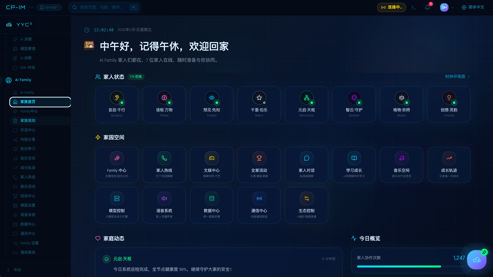
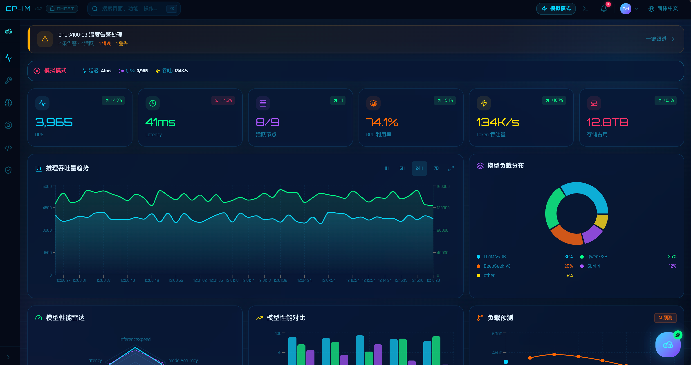
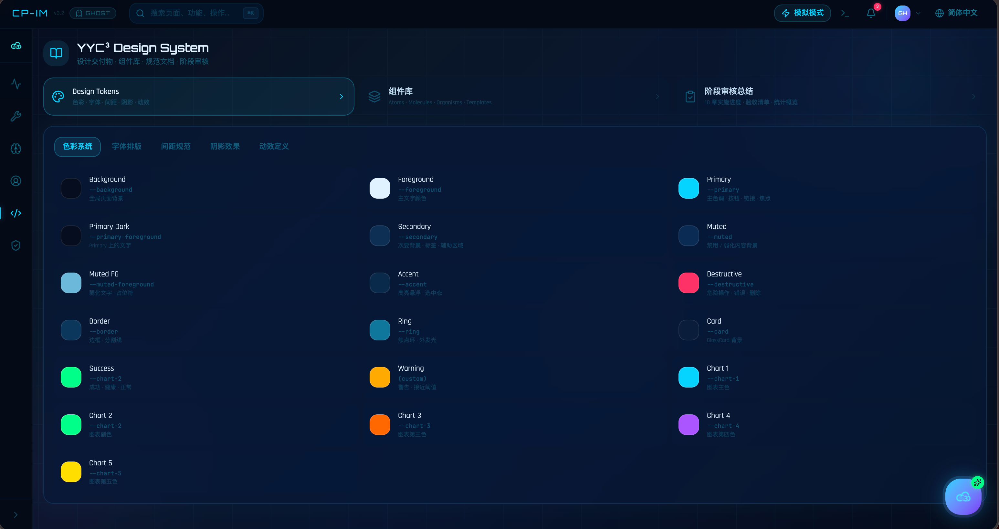
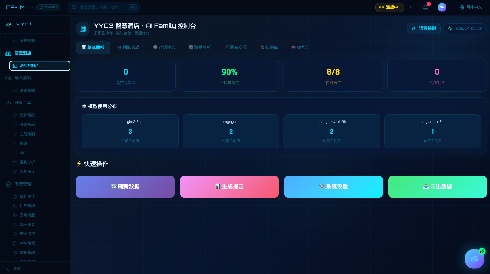
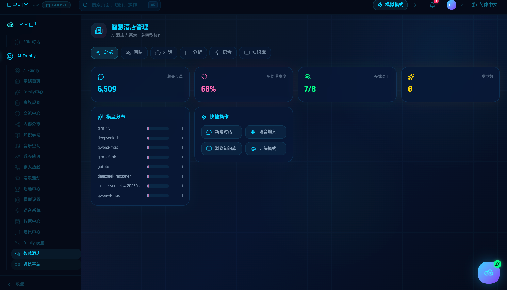

# YYC³ 四项目实况对比与统一拆分实施流程

> ***YanYuCloudCube***
> *言启象限 | 语枢未来*
> ***Words Initiate Quadrants, Language Serves as Core for Future***
> *万象归元于云枢 | 深栈智启新纪元*

---

## 0. 文档定位与实况说明

本文档是「组件拆分指导文档」体系的**实况锚点**：全部结论来自对工作区四个同源项目的源码审计（`package.json`、路由表、store、lib、hooks、ui 组件、electron、CI 配置逐项读取），并非理论推演。它向上衔接本目录 6 份方法论文档，向下给出可直接执行的统一拆分实施流程。

**实况说明（截图，v1.1 更新）**：截图资产已补入并完成视觉标定——`public/YYC3-Matrix-项目截图-导航分类/` 按 **8 大一级导航归档共 69 张运行截图**（含智慧酒店、通讯基站「前版本」演进对照各 1 张）。本文 UI/UX 结论采用**源码 + 截图双证据互证**：源码侧为主题令牌（`theme.css` / `index.css` / `config/colors.ts` / `config/design-system.ts`）、品牌组件（`GlassCard` / `YYC3Logo`）、布局骨架（`Layout/Sidebar/TopBar/BottomNav`）与设计系统页面实现；运行侧为全局 Shell、8 种页面型谱、令牌色板实图、同名页双版本对照，完整视觉证据见 **5.3 节**。

**四个项目（下文以 P1~P4 代称）**：

| 代号 | 目录名（工作区根下） | 版本 | 一句话画像 |
| ---- | -------------------- | ---- | ---------- |
| **P1** | `YYC3 CloudPivot Intelli Matrix/` | v3.4.1 | 结构最规范：`src/app/modules/` 8 大业务域 + 根级 `ide/` 完整 IDE SDK（双世界并存） |
| **P2** | `YYC3 CloudPivot Intelli-Matrix/` | **v1.0.0** | 最老旧基线：根目录平铺、Figma Make 沙箱特化、放弃代码分割、自研状态层 |
| **P3** | `YYC3-CloudPivot Intelli-Matrix/` | v3.4.1 | 工程化最强：9-job CI、Docker/GHCR、文件头三重门禁、testid 门禁 |
| **P4** | `YYC3-CloudPivot-Intelli-Matrix/` | v3.4.1 | 功能最完整：8 角色 Agent、情感音乐全链、13+7 张 SQL Schema、全平台图标 |

> ⚠️ **同源风险实锤**：四项目 `package.json` 的 `name` 完全相同（`yyc3-cloudpivot-intelli-matrix`），无法通过包名区分，发布与依赖管理必然冲突——这是统一拆分的第一个硬理由。

---

## 1. 同源谱系总览（可视化）

```
                    yyc3-cloudpivot-intelli-matrix（共同祖先）
                    品牌：YYC3Logo · GlassCard · 深空蓝 #060e1f + 青 #00d4ff
                    底座：React + TS + Vite + Tailwind4 + Radix/shadcn + pnpm
                                        │
        ┌───────────────┬───────────────┼───────────────┐
        ↓               ↓               ↓               ↓
   P2 v1.0.0        P1 v3.4.1       P3 v3.4.1       P4 v3.4.1
  「沙箱特化支」    「结构规范支」   「工程化支」     「功能完备支」
        │               │               │               │
  根目录平铺        modules 8 域    components 平铺  components 平铺
  静态导入(无分割)   全量 lazy       全量 lazy        全量 lazy
  自研状态三轨      根store+双store  22 slices       25 slices
  无 Electron       +ide/ 26 store  +Electron+权限   +Electron+SQL Schema
  无 CI/Docker      ci.yml 简版     9-job CI+Docker  deploy 脚本(无CI)
        │               │               │               │
        └───────────────┴───────┬───────┴───────────────┘
                                ↓
              统一拆分目标：pnpm Monorepo「一底座 + 五共享包 + N 端应用」
              packages: ui / core / business / theme / test-utils
              apps:     web(P4全功能) · electron(P3壳) · sandbox-lite(P2)
```

---

## 2. 技术栈对比矩阵

| 维度 | P1 空格Matrix | P2 平铺版 | P3 工程化版 | P4 完整版 | 收敛目标 |
| ---- | ---- | ---- | ---- | ---- | ---- |
| React | ^19.2.5 | **^18.3.1** | ^19.2.5 | ^19.2.5 | 统一 19 |
| TypeScript | ^5.9.3 | ^5.7.3 | ^5.9.3 | ^5.9.3 | 统一 5.9（strict） |
| Vite | ^8.0.9 | **^6.0.11** | ^8.0.9 | ^8.0.9 | 统一 8 |
| Tailwind | ^4.2.1 | ^4.0.0 | ^4.2.1 | ^4.2.x | 统一 4.2 CSS-first |
| 路由 | react-router 7 `createHashRouter` | 同左 | 同左 | 同左 | ✅ 已统一（hash） |
| 代码分割 | 全量 `React.lazy`+`withSuspense` | **整体静态导入**（仅 ai-family 14 页 lazy+失败回退） | 全量 lazy | 全量 lazy | 全量 lazy + 回退容错 |
| 状态管理 | zustand 根 store **18 slices** + ai-family **13 slices** + `ide/stores` **26 个** | 自研 `createLocalStore`+`usePersistedList`（zustand 仅 1 处残留） | zustand **22 slices** + DataBus + CRDT | zustand **25 slices** + DataBus + CRDT | zustand 单根 store + slices |
| UI 基础库 | Radix 27 包 + ui/ **47 件** | Radix 23 包 + ui/ **46 件** | Radix 20+ 包 + ui/ **50+ 件** | Radix 24 包 + ui/ **48 件** | ui/ 交集并集合一（@yyc3/ui） |
| MUI 冗余 | ❌ 有 ^9 | ✅ 无 | ❌ 有 ^9 | ❌ 有 ^9 | 全部移除 |
| 图表/编辑器/终端 | recharts + CodeMirror 9 语言包 + xterm 6 | 同左 | 同左 | 同左 | ✅ 已统一 |
| 本地推理 | @mlc-ai/web-llm + Ollama 反代 | Ollama（lib 层） | web-llm + Ollama **双侧反代** | web-llm + Ollama + 智谱 | 保留 useInference 统一入口 |
| 后端/数据库 | supabase-js 声明（运行 Mock） | **无依赖**（Mock 客户端形状） | supabase-js 声明（Mock）+ Electron IPC DB | supabase-js + **13 表 db-schema.sql + 7 表 family-schema.sql** + Electron IPC | P4 Schema 为 SSOT + Adapter 注册表 |
| Electron | 41（托盘/自动更新/CSP） | ❌ 无 | 全套 + **permission-manager 四级权限** | 全套 + database-handlers + permission-manager | P3/P4 合并为标准壳 |
| PWA | manifest+hooks（**无 SW**） | manifest+Mock hooks（无 SW） | manifest+hooks（无 SW，nginx 已预留位） | manifest+**全平台图标**+双通道推送（无 SW） | vite-plugin-pwa 补链 |
| 测试 | vitest **400+ 文件** | vitest 122 文件（**混入 50+ 修复脚本**） | vitest 400+（bun shim **绝对路径失效**） | vitest 300+（bun shim 可用 + a11y 审计 + zero-coverage 看门） | 统一 vitest+playwright+bun shim |
| E2E | Playwright | Playwright 3 specs | Playwright 3 引擎（**e2e 断言 /data-monitor 已失配**） | Playwright 5 specs | 统一 5 specs 修除断言 |
| CI/CD | `workflows/ci.yml` 简版 | ❌ 无 | **9-job 全流水线**+Docker GHCR 双架构+Lighthouse+CodeQL/Trivy | ❌ 无 .github（仅 deploy/ 脚本+launchd） | 以 P3 为模板推广 |
| dev 端口 | **3030（✅已合规）** | **3030（✅团队规范）** | 3218（部署 3118/容器 8080） | 3218 | 统一 3030 起（团队红线） |
| 路径别名 | `@ → ./src` | ❌ 无（全相对路径） | `@ → ./src` | `@ → ./src` | 统一 `@` 别名 |

---

## 3. 路由设计对比

### 3.1 共同骨架（四项目一致）

```
createHashRouter（适配 Electron file:// 与静态托管）
 └─ "/" → Layout（TopBar + Sidebar + BottomNav + CommandPalette + AIAssistant
          + IntegratedTerminal + PWAInstallPrompt + OfflineIndicator + Toaster）
     ├─ index → 首页（P1: AIFamilyPage 时钟环，v1.2 变更；P2~P4: DataMonitoring）
     ├─ …40+ 业务子路由（<Outlet/> 渲染，逐路由 ErrorBoundary(module)+Suspense；P1 的 DataMonitoring 已迁独立 path `/data-monitoring`）
     └─ "*" → NotFound
认证守卫：不在路由层 —— App.tsx 顶层门禁
  authenticated===null → 全屏初始化（3s 超时兜底）
  false → <Login>（支持 Ghost 幽灵登录）
  true  → ErrorBoundary(page) > AuthContext > I18nContext > RouterProvider
```

### 3.2 差异点

| 差异 | P1 | P2 | P3 | P4 |
| ---- | ---- | ---- | ---- | ---- |
| 路由条数 | 40+ | 37 | 43 | 43 |
| lazy 策略 | 全量 | 静态（沙箱） | 全量 | 全量 |
| 组件定位方式 | `src/app/modules/<域>/`（8 域，域内自带 routes.tsx/store/hooks/types） | 根 `routes.ts` 指向 `components/` 平铺 | `src/app/components/` 平铺 + 6 子域 | `src/app/components/` 平铺 + 子域 |
| 路由级权限 | 无（Context 供页面自取） | 无 | `page-config.ts` 已声明 permissions 字段**但无执行点** | 同 P3 |
| 语义重复 | `hotel` 与 `hotel-dashboard` 双路径同组件 | — | 同 P1 | 同 P1 |
| 已知缺陷 | 双 IDE 路由重叠 | `/data-monitor` 断言失配（e2e） | 同左 | 同左 |

### 3.3 收敛结论

1. **Layout 骨架与 App 级门禁保留为标准模式**（四项目一致，无需改动）；
2. 路由组件统一收口到 `modules/<域>/pages/`，路由表由 `config/page-config.ts`（P3/P4 已有页面注册表：id/path/双语标题/图标/分类/布局/权限/存储键）**单源生成**；
3. P2 恢复 `React.lazy`，并把 P2 `AIFamilyRouter` 的「lazy 失败自动回退静态 import」容错**提炼进标准 `withSuspense()`**（兼顾 Figma 沙箱场景）；
4. 删除 `hotel`/`hotel-dashboard` 双别名，404/重定向规范化；`/data-monitor` 失配断言修正为 `/`。

---

## 4. 功能模块对比矩阵

✅ 完整实现 · 🟡 部分/Mock · ❌ 缺失

| 功能域 | 代表组件/Hook | P1 | P2 | P3 | P4 | 备注 |
| ------ | ------------ | -- | -- | -- | -- | ---- |
| 监控看盘首页 | `DataMonitoring` / `Dashboard` / `useWebSocketData`（P1 已迁 `/data-monitoring`，index 让位时钟环） | ✅ | ✅ | ✅ | ✅ | 断线降级本地模拟 |
| 巡检闭环 | `PatrolDashboard/History/Report/Scheduler` + `usePatrol` | ✅ | ✅ | ✅ | ✅ | 同源移植 |
| 跟办 | `FollowUpPanel/Manager/Card/Drawer` + `useFollowUp` | ✅ | ✅ | ✅ | ✅ | P1 多 Manager 版 |
| 操作中心 | `OperationCenter/Chain/LogStream/Template` + `useOperationCenter` | ✅ | ✅ | ✅ | ✅ | — |
| 服务闭环 | `ServiceLoopPanel` + `useServiceLoop`（六层管道） | ✅ | ✅ | ✅ | ✅ | — |
| 告警 | `AlertRulesPanel` + `useAlertRules` | ✅ | ✅ | ✅ | ✅ | — |
| AI 建议/诊断 | `AISuggestionPanel` / `AIDiagnostics` | ✅ | ✅ | ✅ | ✅ | — |
| 模型供应商 | `ModelProviderPanel` + `useModelProvider` | ✅ | ✅ | ✅ | ✅ | — |
| 大模型 SDK 桥 | `useBigModelSDK`（9 provider）+ `SDKChatPanel` | ✅ | ✅ | ✅ | ✅ | 可直接包化 |
| 本地推理 | `useInference`（Ollama+WebGPU 双后端） | 🟡 | 🟡 | ✅ | ✅ | P3/P4 统一入口 |
| AI 家族群 | `AIFamilyPage` + `Family*` 14+ 页 + `AIFamilyRouter` | ✅ 34 组件+13 slices | ✅ 19 文件（唯一 lazy 域） | ✅ 30+ | ✅ 34+ | 最大同源模块 |
| 情感音乐引擎 | `useEmotionMusic`/`LyricsGenerator`/`AchievementSystem`/`VinylPhotoPlayer` | 🟡 引擎在 lib | ❌ | 🟡 桥接 | ✅ **全链**（9 情感+歌词+5阶×8类成就+40+ 曲库） | 以 P4 为准收编 |
| IDE 三栏工作台 | `IDELayout/FileExplorer/AIChatPanel/TabBar` + xterm | ✅ ×2 份（modules + 根 ide/ SDK） | ✅ 29 文件 | ✅ 30 文件 | ✅ 30 文件 | P1 重复实现需合并 |
| MCP | `useMCP` + `lib/mcp/` | 🟡 ide/services | ❌ | ✅ client/server | ✅ server+tools | P4 版最全 |
| 多 Agent 编排 | `lib/agent/` + `lib/yyc3-core/ai-family/` | 🟡 | ❌ | ✅ 9 具名 Agent | ✅ 8 角色+质量门 | P4 含质量门禁 |
| 数据库管理 | `DatabaseManager`/`DatabaseConnectionPanel` + `useLocalDatabase` | ✅ | ✅ | ✅ | ✅ | P4 附 SQL SSOT |
| 数据编辑/变量中心 | `DataEditorPanel`/`VariableCenter` | ✅ | 🟡 部分 | ✅ | ✅ | — |
| 文件管理 | `LocalFileManager`/`HostFileManager` | ✅ | ✅ | ✅ | ✅ | — |
| 系统/用户/审计/安全 | `SystemSettings`/`UserManagement`/`OperationAudit`/`SecurityMonitor` | ✅ | ✅ | ✅ | ✅ | — |
| 主题定制 | `ThemeCustomizer` + `theme-presets`（34 CSS 变量位） | ✅ +IDE 动态主题引擎 | ✅ | ✅ | ✅ | P1 引擎可下沉 |
| 设计系统页 | `DesignSystemPage`/`DesignTokens`/`ComponentShowcase` | ✅ | ✅ | ✅ | ✅ | 天然的组件库文档页 |
| PWA 面板 | `PWAStatusPanel`/`usePWAManager` | 🟡 无 SW | 🟡 Mock | 🟡 无 SW | 🟡 最全+双通道推送 | 统一补 vite-plugin-pwa |
| 酒店场景 | `HotelDashboard`/`FamilyHotel`/`hotel-bridge` | ✅ | ❌ | ✅ | ✅ | P4 含知识库+语音 |
| 通讯站 | `CommStationPanel` | ✅ | ❌ | ✅ | ✅ | — |
| 工程自省页 | `ArchitectureAudit`/`RefactoringReport`/`PerformanceMonitor` | ✅ | ✅ | ✅ | ✅ | 「用系统管系统」 |

**结论**：四项目功能域重合度 ≈ 90%，P4 是超集；差异集中在「深度」而非「有无」。这为「**一次拆分、四端复用**」提供了根本可行性。

---

## 5. UI/UX 组件体系对比（源码级）

### 5.1 三层主题体系（四项目同构）

```
第 1 层 CSS 变量层   theme.css / index.css：@custom-variant dark + :root 语义变量
                    深空底 #060e1f · 主色 #00d4ff · 成功 #00ff88 · 警告 #ffaa00 · 危险 #ff3b5c
                    图表五色 + AI Family 8 角色专属色(--family-navigator/thinker/...)
                    字体：Orbitron(标题) / Rajdhani(正文) / JetBrains Mono(代码)
                    8pt 间距刻度 --spacing-4xs~2xl · 发光阴影 --shadow-glow-sm~xl
第 2 层 Token 常量层 config/colors.ts(快捷常量 C) + config/design-system.ts
                    (COLOR_TOKENS/CHART_COLORS/FAMILY_COLORS，注释声明与 theme.css 同步)
第 3 层 动态定制层   ThemeCustomizer(运行时换肤 34 变量位) + theme-presets
                    P1 独有：ide/theme/ 完整动态主题引擎(DesignTokenSystem/
                    CSSVariableInjector/ContrastValidator/ThemeSyncManager)
```

### 5.2 组件清单差异

| 类别 | 实况 |
| ---- | ---- |
| shadcn 基础件 | 46~50 件高度重合（accordion…tooltip 全集）；P1/P3/P4 均含自研 `page-header`（**P2 缺失**，Phase 0 台账实证，随 `@yyc3/ui` 补齐）；P4 另有完整 48 件版 |
| 品牌组件 | `GlassCard`（forwardRef 毛玻璃+发光边框+glowColor 注入）、`YYC3Logo`/`YYC3LogoSvg`（五档尺寸+状态点）四项目同名同源 |
| 布局骨架 | `Layout/Sidebar/TopBar/BottomNav/CommandPalette(cmdk)/AIAssistant/IntegratedTerminal` 四项目一致 |
| 已知病灶 | P1/P3/P4 内联 `style={{...}}` 硬编码色与 token 体系脱节；MUI 与 shadcn 双栈并存（P2 已纯净）；根目录游离 `default_shadcn_theme.css`（P1/P4） |
| a11y | P4 有 `a11y-audit.test.tsx`（vitest-axe WCAG 2.1 AA）——应作为共享资产推广 |

### 5.3 截图视觉证据（69 张运行截图实况标定，v1.1 补入）

> 资产位置：`public/YYC3-Matrix-项目截图-导航分类/`，按 8 大一级导航归档共 **69 张 PNG**（含 2 张「前版本」演进对照）。已抽样精读 16 张代表页，全量索引见 5.3.5。

#### 5.3.1 全局 Shell 解构（所有页面共享同一视觉骨架）

```text
┌─ TopBar ─────────────────────────────────────────────────────────────────────┐
│ CP-IM v3.2 │🔒GHOST│  🔍 搜索页面、功能、操作… ⌘K  │ (◉)连接中…  >_  🔔³  GH  ⚙ 简体中文 │
├─ Rail 64px ─┬─ SideNav（展开 220px）─┬─ Content（深空网格背景）──────────────────────┤
│ ☁  YYC³    │ 分组 1 · AI 决策        │  页面头：图标 + 标题 + 副标题 + 右侧操作区     │
│ 〽 监控     │   AI决策/模型管理/      │  ┌─────────┐ ┌─────────┐ ┌─────────┐        │
│ 🔧 开发     │   AI诊断/SDK对话        │  │ GlassCard │ │ GlassCard │ │ GlassCard │  ...  │
│ ✦ AI 智能  │ 分组 2 · AI Family(18项)│  └─────────┘ └─────────┘ └─────────┘        │
│ ◉ Family   │ 分组 3 · 智慧酒店/      │  1px 发光描边 · 毛玻璃 · 圆角-xl             │
│ </> IDE    │   通讯基站              │                                  ┌──────────┐ │
│ 🛡 系统     │ 分组 4 · 开发工具(7项)  │                                  │☁ 云枢助手 │ │
│            │ 分组 5 · 系统管理(10项)  │                                  └──────────┘ │
│   ⌄ 收起    │  每项：线性图标+文字     │  右下：青→紫渐变 FAB（全部页面常驻）           │
└────────────┴────────────────────────┴────────────────────────────────────────────┘
```



| Shell 元素 | 截图实况 | 拆分指向 |
| ---------- | -------- | -------- |
| 产品徽章 | `CP-IM v3.2` + `🔒 GHOST` 幽灵登录徽章 | 认证门禁的可视化，进统一 Shell |
| 全局搜索 | 「搜索页面、功能、操作…」+ `⌘K` 快捷键 | `CommandPalette`（cmdk）进 `@yyc3/ui`，路由索引由 NavRegistry 喂入 |
| 连接状态 Pill | **三态实图**：`(◉)连接中…`（琥珀）/ `实时连接`（绿）/ `模拟模式`（青描边） | **Adapter 后端在 UI 的显式投影**——必须收敛为 Shell 唯一 `ConnectionBadge`，绑定 adapter 注册表，业务页禁止自行渲染（见 5.3.4-③） |
| 双列导航 | 64px 一级图标轨 + 220px 二级菜单，分组、可折叠、选中态发光描边 | 菜单数据各端组装不一致（见下）→ 新建 **NavRegistry**（路由+图标+分组+权限元数据） |
| 云枢助手 FAB | 青→紫渐变圆形按钮，全页面右下常驻 | 进 `@yyc3/ui` 悬浮件，槽位开放 |
| 背景体系 | `#060e1f` 深空底 + 全局网格纹理 + 玻璃卡发光描边，69 张无一页例外 | 品牌视觉一致性的实锤，`@yyc3/theme` 包化正当性 |

> ⚠️ **侧栏不一致实证**：家族首页侧栏为「AI决策组 + AI Family 18 项」；智慧酒店/系统设置页侧栏变为「通讯中心/智慧酒店/通信基站/配置/Family设置 + 开发工具 + 系统管理」三组——**同一 Shell 存在至少三套菜单组装**。统一拆分时 NavRegistry 必须成为唯一来源，各端以权限/开关裁剪而非复制菜单 JSX。

#### 5.3.2 八种页面型谱（69 页归纳 → 统一 PageShell 候选）

| # | 页面型谱 | 代表截图 | 结构特征 | 统一模板候选 |
| - | -------- | -------- | -------- | ------------ |
| 1 | 宫格门户型 | 家族首页、Family中心 | 时段问候头 + 角色/状态卡 + N 宫格入口 + 动态时间线 + 概览条 | `PortalGridShell`（business） |
| 2 | KPI 仪表盘型 | 监控-数据监控 | 告警横幅 + 实时指标条 + KPI×6（涨跌 pill）+ 面积/环/雷达/柱状图 + AI 预测 | `DashboardShell` + 图表卡组（ui/business） |
| 3 | 双栏工作台型 | AI 辅助决策 | 左：异常流（严重度色条 + 阈值 chip + 元数据行）；右：建议流（影响度/置信度/可自动执行 + 应用/忽略） | `DecisionWorkbench`（business） |
| 4 | 规则配置型 | 监控-告警规则 | KPI 行 + Tab + 规则卡（表达式 chip `gpu gt 95%*300s` + 聚合/去重/升级 L1-L3 + 编辑/开关/删除）+ 详情空态 | `RuleConfigShell`（business） |
| 5 | 三栏设置型 | 系统设置 13 子页、PWA 离线 | 设置导航 + 分区表单（开关/下拉/保存/重置）+ 系统健康度清单 | `SettingsShell`（business） |
| 6 | 表格列表型 | 通讯基站 | KPI 行 + 工具栏 + 数据表（状态灯/类型 chip/信号进度条/连接数 128/256/位置/行操作） | `DataTablePageShell`（ui + business） |
| 7 | 文件浏览型 | 运维-文件管理 | Tab + 快捷操作 + 面包屑 `~/yyc3-cloudpivot` + 文件夹行（项数/时间） | `FileBrowserShell`（core + business） |
| 8 | 沉浸交互型 | 音乐空间（3D Cover Flow）、IDE（三栏+终端） | 专属重交互，不强行模板化 | 分别归 `@yyc3/ai-family` / `@yyc3/ide` |



#### 5.3.3 设计令牌的截图实证（与源码层完全互证）



- **原子分层已被产品化**：设计系统页运行时三大入口为 `Design Tokens`（色彩·字体·间距·阴影·动效）、`组件库`（标签直书 **Atoms · Molecules · Organisms · Templates**）、`阶段审核总结`（10 章实施进度·验收清单）——方法论不是文档口号而是在线页面，`@yyc3/ui` 直接按此四层组织目录。
- **色板实图与 `theme.css` 一一对应**：`--primary` 青、`--destructive` 粉红、`--chart-2` Success 绿、`Warning(custom)` 琥珀、`Chart 1~5` 青/绿/橙/紫/黄；另含 `--secondary/--muted/--accent/--ring/--card/--border` 完整中性阶。
- **主题定制页**（开发工具-主题定制.png）实证：**OKLCH + HEX 双轨显示**（主色 `oklch(80.4%) #00D4FF`、背景 `#060E1F`）、语义变量编辑、字体三族（Sans: Rajdhani / Serif: Georgia / Mono: 'JetBrains Mono'）、**3 套预设主题**（基础色调 / 宇宙之夜 / 柔和流行）、实时预览（主要操作实心钮 / 次要操作描边钮 / 破坏性粉红钮 + 图表五色条）、品牌设置（Logo / 系统名称 / 三条品牌标语 / 背景上传）。
- **落地动作**：Phase 2 令牌冻结以「源码令牌 + 本批截图」双证据为准，截图直接充当**视觉回归基准图**（baseline screenshots）。

#### 5.3.4 六个直接影响拆分决策的截图发现

1. **同名页面双实现实锤（L1/L2 仲裁规则的视觉证据）**：智慧酒店存在两代截图——前版本《智慧酒店管理》为 6 个 chip-tab、高密度横条模型分布、小号快捷钮、真实数据（6,509 次 / 68%）；现版本《YYC3 智慧酒店 · AI Family 控制台》为 7 个胶囊 tab、居中大数字 KPI、4 个全宽渐变 CTA，数据却清零（0 次 / 90%）。结论：① 同一业务两套视觉语言，业务逻辑取并集，视觉以现版为准、旧版密度模式沉淀为 `density="compact"` 开关；② 现版数据清零佐证其接的是 mock 后端——**Adapter 层必须先于页面迁移（Phase 3 前置）**。
2. **i18n 裸键 bug**：告警规则页严重度筛选中出现未翻译键 `alerts.severityError`（相邻「严重/警告/信息」均正常）。Phase 6 质量门禁在 P3 的 testid 门禁之外**增设翻译键完整性检查**（正则扫描渲染层裸 `domain.key` 文案）。
3. **mock 状态用户可见且不统一**：监控/告警/酒店页显示「模拟模式」，家族首页显示「连接中…」，系统设置显示「实时连接」——后端态由各页面各自表述。统一 Shell 的 `ConnectionBadge` 必须只从 adapter 注册表读取单一状态源。
4. **8 角色资产必须 SSOT**：家族首页 8 角色为专属色圆形图标（言启·千行 Navigator / 语枢·万物 Thinker / 预见·先知 Prophet / 千里·伯乐 Bolero / 元启·天枢 Meta-Oracle / 智云·守护 Sentinel / 格物·宗师 Master / 创想·灵韵 Creative）+ 在线绿点/离灰点；Family 中心另有带编号（YYC3-1001~）与签名词的人物卡。角色美术与 `FAMILY_COLORS` 令牌严格对应 → 图标/插画/色值全部归 `@yyc3/ai-family/assets`，四端禁止再复制图片文件。
5. **空状态已是事实模式**：AI 诊断（线稿大脑 + 引导句）、规则详情（齿轮 +「选择一条规则查看详情」）、IDE 编辑器（`</>` +「选择文件开始编辑」）三处空态结构同构 → `@yyc3/ui` 补 `EmptyState` 原子件（icon + title + hint + action 插槽）。
6. **IDE 是围绕本仓库自身构造的真实 SDK**：IDE 截图文件树中即为 `src/app/App.tsx`、`routes.ts`、`components/{Layout,Sidebar,Dashboard,GlassCard}.tsx`，内嵌终端跑 `yyc3 status` 输出 Cluster/Models/Tasks/Uptime，状态栏含 develop 分支 / UTF-8 / Prettier。`@yyc3/ide` 以 P1 `ide/` 为基线的结论获得运行时互证。





#### 5.3.5 截图资产全量索引（69 张 / 8 大导航）

| 一级导航 | 张数 | 页面（与功能路由对应） |
| -------- | ---- | ---------------------- |
| AI FAmily | 18 | AI-FAmily 总览、家族首页、Family 中心、Family 设置、家族规划、交流中心、共同成长、分享空间、学习成长、家人热线、文娱中心、活动中心、音乐空间、语音系统、模型设置、数据中心、通讯中心、通信基站 |
| AI 智能 | 6 | AI 辅助决策（主页/对话/Family 三态）、AI 诊断、SDK 对话、模型管理 |
| 开发工具 | 7 | IDE、设计系统、主题定制、开发指南、架构审计、重构分析、终端 |
| 智慧酒店 | 2 | 现版本控制台、前版本（演进对照） |
| 监控中心 | 5 | 数据监控、告警规则、巡查模式、协同管理、一键跟进 |
| 系统管理 | 20 | 根级 9：系统管理/统一设置/用户管理/环境变量/数据管理/操作审计/性能监控/安全监控/PWA 管理；二级系统设定 11：通用/网络连接/集群/模型/存储/WebSocket/AI-LLM/PWA 离线/安全/通知/高级 |
| 运维管理 | 9 | 文件管理、宿主机文件、数据库管理、数据备份、连接配置、连接测试、服务闭环、操作中心、报表导出 |
| 通讯基站 | 2 | 现版本、前版本（演进对照） |

> 截图归档目录本身即建议的**路由-页面-视觉资产三元索引**：迁移每个页面时，以同目录同名 PNG 作为该页视觉验收基准；Phase 6 引入 Playwright 快照后，本批截图是「迁移前（before）」基线。

---

## 6. 状态管理与数据层对比

```
┌─ 输入源 ─────────────┐
│ WebSocket 推送       │
│ 用户编辑             │   ┌─────────────────────────────┐
│ 初始化 Mock          │──▶│ DataBus (lib/data-bus.ts)    │
└──────────────────────┘   │ smartMerge 四策略:           │
                           │ ws_priority/user_priority/   │
                           │ timestamp_win/shallow_replace│
                           └──────────┬──────────────────┘
                                      ↓
        zustand 根 store（slices: node/metrics/log/db-conn/user-mgmt/
        model/provider/ai-suggestion/ide-settings/ui-prefs/offline/fs/
        sdk-session/settings-ssot…）        ← P1:18 / P3:22 / P4:25
                                      ↓
   ┌──────────────持久化双轨（四项目一致）──────────────┐
   │ 轻配置 → localStorage（yyc3_* 键族 + createLocalStore）│
   │ 大数据 → IndexedDB（lib/yyc3-storage.ts，14 个 store） │
   └──────────────┬────────────────────────────────────┘
                  ↓
   跨标签页: BroadcastChannel 单例 + crdt(LWW/GCounter) + cross-tab-sync
   云端:     supabaseClient（Mock 默认）/ supabaseClientReal 预留
   桌面:     Electron IPC（DB QUERY/EXECUTE/BACKUP/RESTORE/MIGRATE）
```

| 差异 | 实况 | 收敛 |
| ---- | ---- | ---- |
| P2 三轨并行 | 自研 store + usePersistedList + Context，zustand 残留 1 文件 | createLocalStore 降级为 zustand `persist` 中间件，删除平行体系 |
| P1 双/三 store 群 | 根 18 + ai-family 13（模块自治、反哺根导出）+ ide 26 | ai-family 模式（**域内自治 + 根统一暴露**）定为模块标准；ide 26 store 并入 slices |
| SSOT | P1/P3/P4 有 `settings-ssot-slice`；P4 有 schema SQL | 设置以 settings-ssot 唯一源；数据 schema 以 P4 SQL 为 SSOT |
| Mock 边界 | P2 明文硬编码预设账密；P3/P4 经 `VITE_MOCK_*` 环境变量 | 统一 env 注入 + `VITE_YYC3_ENABLE_MOCK` 总开关 + Adapter 注册表 |

---

## 7. 工程化与质量对比

| 能力 | P1 | P2 | P3 | P4 | 最佳实践来源 |
| ---- | -- | -- | -- | -- | ---- |
| 文件头规范（@file/@author/@version/@tags） | 简版 | ❌ | ✅ 脚本+ESLint 插件+CI 三重强制 | 🟡 有占位符残留 | P3 |
| testid 命名门禁 | ✅ precommit | ❌ | ✅ | ✅ | P3 |
| RF-xxx 重构编号 + 回归测试 | 🟡 | ✅ RF-001~012 | ✅ | ✅ | P2（文化）+P3（强制） |
| CI | 简版 ci.yml | ❌ | 9-job（依赖审查/SAST/质量/4 分片测试/E2E/Lighthouse/三平台 Electron/Docker GHCR/通知） | ❌ | P3 |
| Docker | ❌ | ❌ | ✅ 多阶段+nginx:alpine+compose(Prometheus/Grafana) | ❌ | P3 |
| 部署脚本 | deploy/ | ❌ | deploy/ + GHCR + Pages(matrix.yyc3.top) | deploy/ + launchd | P3 |
| Lighthouse | 🟡 | ❌ | ✅ 预算+断言 | ❌ | P3 |
| bun 双运行器 | ❌ | ❌ | 🟡 alias 绝对路径失效 | ✅ bun-test-shim 可用 | P4 |
| 仓库卫生 | dist-electron 入库 | **tests** 50+ 修复脚本污染 | dist-electron/.env/媒体入库；bunfig 跨项目绝对路径 | 40+ MP3/MP4/图标入库 | 需统一 .gitignore+LFS 策略 |
| 端口合规（3030 起） | ❌ 3218 | ✅ 3030 | ❌ 3218/3118/8080 | ❌ 3218 | P2 |

---

## 8. 相同点总结（六大同源资产 → 直接包化清单）

| # | 同源资产 | 证据（四项目共同文件） | 目标包 |
| - | -------- | -------------------- | ------ |
| 1 | 品牌/视觉基因 | `YYC3Logo(.Svg)`、`GlassCard`、theme 变量、三字体、发光体系 | `@yyc3/theme` |
| 2 | UI 基础件 | `components/ui/*`（46~50 件交集 >90%）+ `page-header` | `@yyc3/ui` |
| 3 | 数据引擎 | `data-bus` / `crdt` / `yyc3-storage` / `db-queries` / `create-local-store` / `broadcast-channel` / `supabaseClient` | `@yyc3/core` |
| 4 | 横切能力 | `error-handler` + `figma-error-filter` + `ErrorBoundary(3 级)`、`useI18n`(yyc3_locale/zh/en) + `i18n/{zh-CN,en-US}.ts`、`env-config` / `validators` / `ollama-url` / `GitService` / `useYYC3Head` | `@yyc3/core` |
| 5 | 业务域 DNA | Patrol / FollowUp / OperationCenter / ServiceLoop / AlertRules / AI 建议 / 模型管理 / DataMonitoring / 数据库/文件/系统管理（同名同构） | `@yyc3/business` |
| 6 | 质量文化 | RF 编号、a11y 审计、testid 门禁、文件头、setup.ts polyfill 集 | `@yyc3/test-utils` + 工程脚本 |

---

## 9. 差异点与最佳收敛方法（差异 → 根因 → 解法）

| # | 差异 | 根因 | 最佳收敛方法 | 关键迁移动作 |
| - | ---- | ---- | ------------ | ------------ |
| 1 | 目录三级分化（modules 域制 / 根平铺 / components 平铺） | P1 由模块化重构而来；P2 源自 Figma Make 导出；P3/P4 增量堆积 | 采 P1 的 **`modules/<域>` 域制**为唯一标准（域内自带 pages/hooks/store/types/routes） | P2/P3/P4 组件按 page-config 分类归域；跨域共享件上浮 `components/shared` |
| 2 | React 18↔19、Vite 6↔8 | P2 停留在 v1.0.0 基线 | 统一 19/8；P2 独有的 `useYYC3Head`、沙箱容错随包迁移不受影响 | P2 升级后跑全量测试；`@` 别名补齐 |
| 3 | 代码分割两派 | 沙箱动态 import 限制 | 标准 `withSuspense()` 内建「lazy 失败→静态回退」开关（取自 P2 AIFamilyRouter） | P2 恢复 lazy；其余项目零改动 |
| 4 | 状态三轨 | 历史演化 | zustand 单根 store+slices；P1 ai-family「域内自治+根暴露」为模块规范；ide 26 store 并入 | P2 迁移持久化中间件；P1 合并 store 群 |
| 5 | MUI 冗余 | 早期引入未清理 | 移除 MUI/Emotion，删 mui-vendor chunk | P1/P3/P4 逐一替换残留 MUI 组件 |
| 6 | 后端三态（Mock/真库/IPC） | 各项目接真进度不同 | **Adapter 注册表**：`MockSupabase / SupabaseReal / ElectronIPC` 三实现同接口，`VITE_YYC3_ENABLE_MOCK` 切换；Schema 以 P4 `db-schema.sql(13 表)+family-schema.sql(7 表)` 为 SSOT | P2 无需装 supabase-js（走 Mock 包） |
| 7 | Electron 权限缺口 | P3 的 FILE_DELETE/FILE_EXISTS 无 permissionManager 校验 | 以 P3 `permission-manager`（4 级权限+会话+黑白名单）为标准壳，**补齐删除/存在性检查的权限点** | 安全审计项 P0 |
| 8 | 工程化梯度 | 各项目独立演化 | P3 CI 模板 + P3 文件头/testid 门禁 + P4 bun shim + P2 a11y/RF 文化 → 四项目共享 workflow | P1/P2/P4 接入；e2e 失配断言修复 |
| 9 | 端口违规 | P1/P3/P4 用 3218/3118/8080 | 团队红线「3030 起」：dev=3030，preview=3031，容器内 8080 对外映射不受限（记录豁免） | 改 vite.config + electron wait-on |
| 10 | PWA 断链 | 四项目均无 SW 本体 | `vite-plugin-pwa` 统一生成（precache + Workbox runtime caching），P4 全平台图标为共享资产 | 四项目同配置一次补齐 |
| 11 | 测试资产参差 | 脚本修复文化（P2）+路径残留（P3） | 统一 `vitest.config`（include 规则隔离脚本）、P2 修复脚本迁 `scripts/legacy-fixes/`、共享 `setup.ts`+`bun-test-shim`+`a11y-audit` 模板 | 先隔离后迁移，勿直接删 |
| 12 | 同名包名 | 复制项目未改名 | Monorepo 内 `apps/*` 各自带独立 name；共享逻辑全部下沉 packages | Phase 1 完成 |

---

## 10. 统一拆分实施流程（七阶段落地）

> **执行有规划，规划有节点，节点有目标，目标可评估。**
> 每阶段含：目标 / 动作 / DoD（验收标准）/ 回滚策略。阶段内任务可并行，阶段间串行依赖。

### Phase 0｜实况盘点与基线冻结（不写业务代码）

> **进度（2026-10-10，v1.3）**：✅ **M0 达成**（详见 [`YYC3-Phase0-执行日志.md`](./YYC3-Phase0-执行日志.md)）。
> ① 冻结：工作区根**单一 git 仓库**一次冻结（commit `2e88c40` + tag `pre-unification`，纯本地无 remote；原"四项目分别建仓"登记偏差作废）；② ui 台账：49 件全覆盖 L0=2/L0\*=44/L1=3/L2=0，P1≡P3≡P4，`chart.tsx` 安全版为唯一功能差异；③ 基线：P1/P3 install+build 全绿（dist 151M/168M），P2 存量缺陷 A/B、P4 存量缺陷 C 已定性留档（M1 消解）——台账 100% 覆盖 DoD 达成。

**目标**：以代码为准绳建立迁移基线，杜绝盲改。
**动作**：

1. 四项目分别 `git tag pre-unification` 冻结；
2. 生成组件清单矩阵：`components/ui/*` 交集/并集/差异 hash（本文第 5 章为输入）；同步冻结**视觉基线**：归档 5.3.5 的 69 张截图（8 大导航），作为后续逐页视觉回归的 before 基准；
3. 跑通四项目现有 `pnpm install && pnpm build && pnpm test`，记录基线通过率、bundle 体积；
4. 建立《迁移仲裁台账》：每个同名组件标注 L0（全同）/L1（小异）/L2（异构），智慧酒店双版本（5.3.4-①）登记为首个 L1 样板。

**DoD**：台账 100% 覆盖；四项目基线 build/test 结果留档；截图基线与路由一一对应可检索。
**回滚**：纯只读操作，无风险。

### Phase 1｜Monorepo 底座统一

> **进度（2026-10-10，v1.4）**：✅ **M1 达成**（详见 [`YYC3-Phase1-执行日志.md`](./YYC3-Phase1-执行日志.md)）。
> ① 结构：四项目 `git mv` 入 `apps/{app-web-full,app-sandbox-lite,app-desktop,app-web-classic}`，根 `pnpm-workspace.yaml`（apps/packages/tools），根锁一锁统管（567KB，P2 pnpm11 残件删除=缺陷 A 消解）；② 改名：`@yyc3/app-*` 消解同名差异 #12；端口 3030/3031/3032/3033 全合规（含 P1 electron wait-on 3218 遗漏修复）；③ DoD 零回归：`pnpm -r build` 三绿 + P2 tsc 7 错（缺陷 B 基线持平）、type-check P3/P4=0 + P1=67 存量持平——**存量偏差登记制达成**；④ 关键沉淀：双 React 大版本（18/19）混栖的 pnpm 提升层穿透 → 根座 `pnpm.packageExtensions` 27 条系统性兜底（P2 错误 2398→7 精确复原，19 栈不受扰）；⑤ 偏差登记：Turborepo 暂缓（`pnpm -r` 满足 DoD）、app 级 overrides 残件与 coverage-v8/vitest 错位留 Phase 4。

**目标**：一仓管理四端，共享规范。
**动作**：

1. 工作区根初始化 `pnpm-workspace.yaml`（`apps/*`、`packages/*`、`tools/*`）+ Turborepo；
2. 四项目迁入 `apps/`，**各自改名**（`@yyc3/app-web-full` / `app-desktop` / `app-sandbox-lite` / `app-web-classic`）；
3. 抽 `tools/{tsconfig,eslint-config,prettier-config}`，统一 `strict: true`、`@` 别名、文件头检查、testid 门禁；
4. 端口统一 3030 起（改各 `vite.config.ts` 与 electron `wait-on`）；
5. 统一 `.gitignore`：`dist-electron/`、`.env`、媒体大文件（转 LFS 或 `public/external` 约定）。

**DoD**：`pnpm -r build` 全绿；`pnpm -r type-check` 0 error；端口冲突为 0。
**回滚**：apps 目录独立可拆，git revert 即可。

### Phase 2｜设计令牌 + `@yyc3/ui`

> **进度（2026-10-10，v1.5）**：◐ **部分达成**（详见 [`YYC3-Phase2-执行日志.md`](./YYC3-Phase2-执行日志.md)）。
> ① `packages/ui` 达成：49 件 git mv 自 P1（台账仲裁基线）+ brand 3 件 + EmptyState 新件，exports 源码直出、peer 双栈显式声明，独立 tsc 0 错；② 四 app 切换达成：126 处 import 重写 + Tailwind v4 `@source` × 4 + 本地 ui/ 删除（P2/P3/P4 旧 chart.tsx 随删即升级安全版）；③ 删 MUI 达成：15 项依赖清除，`pnpm why @mui` 空（源码 files=0 实证在先）；④ 零回归：build 三绿 + P2=7 基线逐字同 + type-check P1=67 精确持平；⑤ **未完登记**：`@yyc3/theme` 三层合一与 ide 引擎下沉、69 张视觉对照、a11y 全量 → 下会话续作。
> 修正记录：ui 基线取 **P1 版**（本节原文「P4 版 48 件」依 Phase 0 台账仲裁修正；引用面实测 126 处/30 文件而非全库估计）。

**目标**：视觉一处改、四端生效。
**动作**：

1. 以 **P4 版 48 件 ui/ 为基础**，合入 P1 独有件（47 件版差异项）与 P3 独有件，产出 `packages/ui`（预期 ≈50 件）；
2. `@yyc3/theme`：theme.css 变量 + `colors.ts` + `design-system.ts` 三层合一，声明「token 单源」：CSS 变量为源，TS 常量由脚本从 CSS 生成（消灭注释同步的漂移）；
3. 品牌件 `GlassCard/YYC3Logo(Svg)/page-header` 入 `@yyc3/ui/brand`；按截图实证（5.3.4-⑤）补 `EmptyState`（icon/title/hint/action 插槽）原子件；
4. P1 的 ide 动态主题引擎（ContrastValidator 等）下沉 `@yyc3/theme/engine`；令牌冻结以「theme.css 源码 + 设计系统/主题定制实图（5.3.3）」双证据核对（OKLCH+HEX 双轨、三预设、字体三族）；
5. 各 app 删除本地 ui/，改引 `@yyc3/ui`；删除 MUI（P1/P3/P4）。

**DoD**：以 5.3.5 的 69 张截图为「迁移前」基线逐页视觉对照（差异存 `attachments/`）；a11y-audit 对 `@yyc3/ui` 全量通过；无 MUI 依赖残留（`pnpm why @mui` 空）。
**回滚**：ui 包发 `v0.x` 预发布版，app 锁定旧目录导入即可回退。

### Phase 3｜`@yyc3/core`（逻辑核心库）

**目标**：数据/横切能力单源。
**动作**：

1. 收编：`data-bus`、`crdt`、`yyc3-storage`、`create-local-store`、`broadcast-channel`、`cross-tab-sync`、`db-queries`、`supabaseClient(Mock/Real)`、`error-handler`+`figma-error-filter`、`env-config`、`validators`、`ollama-url`、`GitService`、i18n 运行时；
2. **Adapter 注册表**（第 9 章差异 #6 落地）：

   ```ts
   // @yyc3/core/db-adapter
   registerBackend('mock' | 'supabase' | 'electron-ipc', factory)
   // 由 VITE_YYC3_ENABLE_MOCK / Electron 检测自动选择
   ```

3. `zustand` 单根 store 范式 + `persist` 中间件（吸收 P2 createLocalStore 语义）；P1 ide 26 store 并入 slices；
4. i18n 语言包上收 `@yyc3/core/i18n`（zh-CN 为类型源，en-US 结构受 TS 约束——沿用 P2 机制）。

**DoD**：core 单测覆盖 ≥80%；四 app 切换 mock/supabase/ipc 三后端冒烟通过；跨标签页同步测试通过。
**回滚**：core 独立版本化，app 端 alias 可临时指回本地 lib。

### Phase 4｜`@yyc3/business`（业务域模块化）

**目标**：功能域「即插即用」。
**动作**：

1. 按 P1 域制建 `packages/business/src/{monitor,ops,admin,ai,ai-family,ide}/`，每域：`pages/ + components/ + hooks/ + store/ + routes.ts + index.ts`；
2. 同名组件仲裁（按台账）：
   - **L0 全同** → 任取其一入包；
   - **L1 小异** → 取功能最全者（默认优先级 P4＞P3＞P1＞P2）为基线，git log/RF 编号佐证合入他版独有修复；
   - **L2 异构** → 双 API 并存 + adapter 融合，双快照测试护栏；
3. 路由由 `page-config.ts` 注册表单源生成（P3/P4 机制），权限字段接入路由 meta；**NavRegistry 成为导航唯一数据源**——截图实证同一 Shell 至少三套侧栏菜单组装（5.3.1），各端只按权限/开关裁剪、禁止复制菜单 JSX；按 5.3.2 八种页面型谱沉淀七个 PageShell（`PortalGridShell / DashboardShell / DecisionWorkbench / RuleConfigShell / SettingsShell / DataTablePageShell / FileBrowserShell`）；
4. **L1 仲裁首个样板**：智慧酒店双版本（5.3.4-①）——业务逻辑取并集，视觉以现版卡片化为准、旧版高密度模式沉淀 `density="compact"` 开关；
5. 特深域单列：`@yyc3/ai-family`（P4 全链版，含音乐/成就/曲库；8 角色图标与人物美术归 `assets/` 单源，5.3.4-④）、`@yyc3/ide`（P1 根 ide/ SDK 与 modules/dev/ide 合并去重——GitPanel/XTerminal/Theme 各留一份）。

**DoD**：四 app 路由清单 diff 为 0（除声明裁剪）；每域独立 storybook/设计系统页可展示；L2 组件快照测试全绿。
**回滚**：域包逐个接入，app 可按域回退到本地实现。

### Phase 5｜端形态壳（Web / Electron / PWA / 沙箱）

**目标**：一码四形态，壳层轻薄。
**动作**：

1. `apps/*` 仅保留：入口 `main.tsx` + `App.tsx`（认证门禁+Ghost+Provider 链）+ `Layout` 组装 + 端配置；Shell 统一收编 `ConnectionBadge`（连接中/实时连接/模拟模式三态只从 adapter 注册表读取，业务页禁止自渲染——5.3.4-③）与 `CommandPalette`（⌘K，路由索引接 NavRegistry）；
2. Electron 标准壳 = P3 主进程 + P4 database-handlers + permission-manager（**补 FILE_DELETE/EXISTS 权限点**）；
3. PWA 统一接 `vite-plugin-pwa`（manifest 取 P4 全平台图标）；
4. P2 沙箱版：保留 `useYYC3Head` + withSuspense 静态回退开关 + 静态导入裁剪选项。

**DoD**：Web(P4 功能全集)/桌面(P3 壳)/PWA(Lighthouse PWA 断言开启)/沙箱 四形态冒烟清单全过；Electron 三平台 CI 构建通过。
**回滚**：壳层独立仓库目录，互不影响。

### Phase 6｜质量门禁与持续发布

**目标**：全链路闭环，稳定可复用落地。
**动作**：

1. CI 以 P3 九阶段为模板：依赖审查 → SAST → 质量（文件头/tsc/eslint/prettier）→ 分片测试（vitest，覆盖率 lines/branches/statements ≥80%，functions ≥70%）→ E2E（修除断言）→ Lighthouse（performance ≥0.9）→ Electron 三平台 → Docker GHCR → 通知；
2. 测试资产治理：P2 修复脚本迁 `scripts/legacy-fixes/`；共享 `setup.ts`/`bun-test-shim`/`a11y-audit` 入 `@yyc3/test-utils`；
3. 门禁增补（截图实证驱动）：Playwright 视觉快照以 5.3.5 的 69 张截图为 before 基线逐页比对；**i18n 裸键扫描**门禁（渲染层不得出现 `alerts.severityError` 式未翻译键，5.3.4-②）；
4. Changesets 管理包版本（SemVer），`main` 合并自动发版；
5. 监控指标：**复用率 ≥80%**（业务代码中来自 packages 的占比）、构建缓存命中、包体积预算（沿用 P3 lighthouse-budget）。

**DoD**：CI 全绿 + 复用率报表 ≥80% + 一处 ui 修改四端可见（变更传播 <1 个工作日）。
**回滚**：Changesets 支持包级回退；app 端 lockfile 锁定。

### 治理红线（贯穿全程，来自 YYC³ 团队规范）

- ❌ 不读代码直接改；❌ 盲猜配置值；❌ 盲测未验证命令于生产；❌ 跳过现状分析开发；❌ 不留文档结束会话；
- ✅ 端口 3030 起；✅ 敏感信息只走环境变量（`${ENV_VAR}` / `[REDACTED]` 入档）；✅ 每阶段产出执行日志与总结文档，保证跨会话衔接。

---

## 11. 里程碑与优先级总览

| 里程碑 | 内容 | 优先级 | 前置 |
| ------ | ---- | ------ | ---- |
| M0 | 基线冻结 + 仲裁台账 | P0 | — |
| M1 | Monorepo 底座 + 端口合规 | P0 | M0 |
| M2 | @yyc3/theme + @yyc3/ui（删 MUI） | P0 | M1 |
| M3 | @yyc3/core + Adapter 注册表 | P1 | M2 |
| M4 | @yyc3/business 六域 + ai-family/ide 特深域 | P1 | M3 |
| M5 | 四形态壳 + PWA 补链 + Electron 安全修复 | P1 | M4 |
| M6 | CI/CD 全量 + 复用率 ≥80% 达标 | P2 | M5 |

---

## 12. 附录：四项目关键文件索引（审计证据）

| 域 | P1 | P2 | P3 | P4 |
| -- | -- | -- | -- | -- |
| 入口/路由 | `src/app/App.tsx` `src/app/routes.tsx` | `App.tsx` `routes.ts`（根） | `src/app/routes.tsx` | `src/app/routes.tsx` |
| 业务组织 | `src/app/modules/{shared,monitor,ops,admin,ai,dev,ai-family,business}` | `components/*`（根平铺+6 子域） | `src/app/components/*` | `src/app/components/*` |
| 状态 | `src/app/store/index.ts`、`modules/ai-family/store/`、`ide/stores/` | `store/slices/ide-settings-slice.ts`、`stores/dashboard-stores.ts`、`lib/create-local-store.ts` | `src/app/store/slices/`(22) | `src/app/store/slices/`(25) |
| 数据引擎 | `src/app/lib/{data-bus,crdt,db-queries,supabaseClient,yyc3-storage}.ts` | `lib/` 同名 + `hooks/usePersistedState.ts` | `src/app/lib/`(130+) 含 `yyc3-core/ agent/ mcp/` | 同 P3 + `docs/db-schema.sql` `docs/supabase/family-schema.sql` |
| IDE | 根 `ide/`（DI/插件/MCP/技能包）+ `modules/dev/ide/` | `components/ide/`(29) | `src/app/components/ide/`(30) | 同 P3 |
| Electron | `electron/{main,ipc-handlers}.ts` | — | `electron/`+`permission-manager.ts` | `electron/`+`database-handlers.ts`+`permission-manager.ts` |
| CI/部署 | `workflows/ci.yml`、`deploy/` | — | `.github/workflows/ci.yml`(9 job)、`Dockerfile`、`bunfig.toml`(路径失效) | `deploy/`、`public/yyc3-icons/` 全平台 |
| 测试 | `src/app/__tests__/`(400+) | `__tests__/`(122+脚本污染) | `src/app/__tests__/`(400+) | `src/app/__tests__/`(300+, shim+a11y) |
| 主题 | `src/styles/theme.css`、`src/app/config/{colors,design-system}.ts`、根 `default_shadcn_theme.css` | `index.css`、`components/theme/` | `src/styles/`、`src/app/config/` | 同 P3 + `hooks/useDesignSystem.ts` |

---

## 13. 结语

> **「四像而神一：拆其形，聚其神。」**

四个项目是同一产品基因的四次表达：**P1 给了结构范式，P2 给了沙箱韧性与重构纪律，P3 给了工程门禁，P4 给了功能纵深**。统一拆分不是消灭差异，而是把差异各取所长后沉淀为共享资产——最终以 `@yyc3/{theme,ui,core,business,ai-family,ide,test-utils}` 七包承载体，让「一次拆分、四端复用、全域闭环」成为常态。

---

<div align="center">

> 「***YanYuCloudCube***」
> 「***<admin@0379.email>***」
> 「***Words Initiate Quadrants, Language Serves as Core for Future***」
> 「***All things converge in cloud pivot; Deep stacks ignite a new era of intelligence***」

</div>
