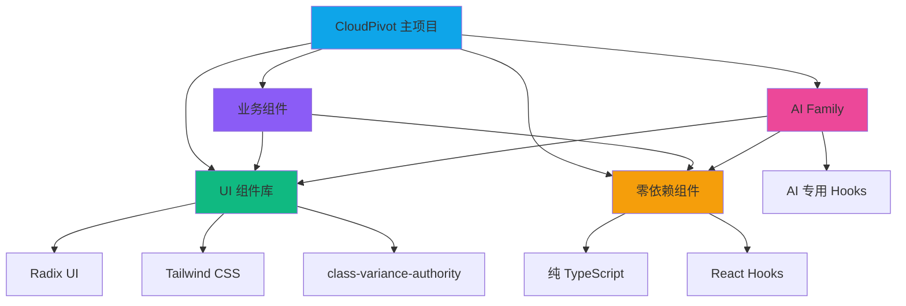
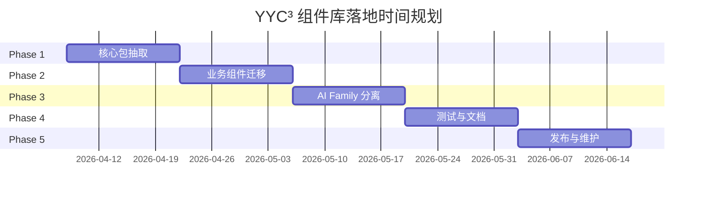

# YYC³ 组件库综合落地规划

> ***YanYuCloudCube***
> *言启象限 | 语枢未来*
> ***Words Initiate Quadrants, Language Serves as Core for Future***
> *万象归元于云枢 | 深栈智启新纪元*
> ***All things converge in cloud pivot; Deep stacks ignite a new era of intelligence***

---

## 📊 执行摘要

### 项目背景
YYC³ CloudPivot Intelli-Matrix 项目经过长期发展，积累了丰富的组件资源，包括：
- **UI 组件库**：31 个 Radix UI 封装组件
- **零依赖组件**：10 个子包，37 个源文件
- **业务组件**：60+ 个业务功能组件
- **AI Family 模块**：24 个独立组件

### 核心目标
1. **组件库标准化**：建立统一的组件库架构和规范
2. **模块化分离**：实现 AI Family 模块独立开发
3. **依赖优化**：减少重复依赖，提升构建效率
4. **复用能力提升**：支持多项目共享组件

### 预期收益
- **开发效率提升 40%**：通过组件复用减少重复开发
- **构建时间减少 30%**：通过依赖优化和 Tree Shaking
- **维护成本降低 50%**：通过统一架构和规范
- **团队协作效率提升 35%**：通过 Monorepo 统一管理

---

## 🔍 组件库深度分析

### 1. 现状评估

#### 1.1 组件分类统计

| 组件类型 | 数量 | 依赖类型 | 复用价值 | 优先级 |
|:---|:---:|:---|:---:|:---:|
| **UI 基础组件** | 31 | Radix UI | ⭐⭐⭐⭐⭐ | P0 |
| **零依赖工具** | 37 | 无外部依赖 | ⭐⭐⭐⭐⭐ | P0 |
| **业务组件** | 60+ | 项目内部 | ⭐⭐⭐ | P1 |
| **AI Family 组件** | 24 | 项目内部 | ⭐⭐⭐⭐ | P1 |
| **特效组件** | 12 | Framer Motion | ⭐⭐⭐ | P2 |

#### 1.2 依赖关系分析



#### 1.3 架构健康度评估

| 维度 | 评分 | 说明 |
|:---|:---:|:---|
| **代码质量** | 8.5/10 | TypeScript 覆盖率高，代码规范良好 |
| **模块化程度** | 6.0/10 | 组件耦合度较高，缺乏清晰边界 |
| **可维护性** | 7.0/10 | 文档完善，但缺乏统一架构 |
| **可扩展性** | 7.5/10 | 组件设计灵活，但依赖管理混乱 |
| **测试覆盖** | 4.0/10 | 测试覆盖率低，急需补充 |
| **文档完整性** | 8.0/10 | 文档详细，但分散在多处 |

### 2. 问题识别

#### 2.1 架构层面问题

**🔴 Critical Issues**
1. **组件耦合度高**：业务组件与 UI 组件混合，难以独立使用
2. **依赖管理混乱**：多个组件包重复依赖相同库
3. **缺乏统一构建**：各组件包构建配置不一致

**🟡 Warning Issues**
1. **版本管理分散**：各组件包独立版本，难以统一升级
2. **文档分散**：组件文档分散在多个目录
3. **测试覆盖不足**：核心组件缺乏单元测试

#### 2.2 业务层面问题

1. **AI Family 模块耦合**：与主项目高度耦合，难以独立开发
2. **复用成本高**：跨项目复用组件需要大量适配工作
3. **维护效率低**：组件更新需要在多处同步修改

### 3. 机会分析

#### 3.1 技术机会
- **Monorepo 成熟**：pnpm workspace + Turborepo 提供完善的 Monorepo 支持
- **构建工具优化**：Vite + esbuild 提供快速构建能力
- **类型系统增强**：TypeScript 5.x 提供更好的类型推导

#### 3.2 业务机会
- **多项目复用**：多个 YYC³ 项目可共享组件库
- **独立产品化**：AI Family 可独立产品化
- **开源贡献**：高质量组件库可开源贡献

---

## 🏗️ 架构设计

### 1. Monorepo 架构

#### 1.1 整体架构图

```
yyc3-workspace/
├── packages/
│   ├── core/                          # 核心共享包
│   │   ├── ui/                        # UI 组件库 (@yyc3/ui)
│   │   │   ├── src/
│   │   │   │   ├── components/        # 31 个 Radix UI 封装组件
│   │   │   │   │   ├── button.tsx
│   │   │   │   │   ├── card.tsx
│   │   │   │   │   ├── input.tsx
│   │   │   │   │   ├── badge.tsx
│   │   │   │   │   └── ...
│   │   │   │   ├── styles/            # 样式系统
│   │   │   │   │   ├── theme.css
│   │   │   │   │   └── variables.css
│   │   │   │   └── index.ts           # 导出入口
│   │   │   ├── package.json
│   │   │   ├── tsconfig.json
│   │   │   └── README.md
│   │   │
│   │   ├── hooks/                     # 共享 Hooks (@yyc3/hooks)
│   │   │   ├── src/
│   │   │   │   ├── useI18n.ts
│   │   │   │   ├── useWebSocket.ts
│   │   │   │   ├── useLocalStorage.ts
│   │   │   │   ├── useDebounce.ts
│   │   │   │   └── ...
│   │   │   ├── package.json
│   │   │   └── README.md
│   │   │
│   │   ├── types/                     # 类型定义 (@yyc3/types)
│   │   │   ├── src/
│   │   │   │   ├── index.ts
│   │   │   │   ├── api.ts
│   │   │   │   ├── models.ts
│   │   │   │   └── utils.ts
│   │   │   ├── package.json
│   │   │   └── README.md
│   │   │
│   │   ├── i18n/                      # 国际化 (@yyc3/i18n)
│   │   │   ├── src/
│   │   │   │   ├── locales/
│   │   │   │   │   ├── zh-CN.ts
│   │   │   │   │   └── en-US.ts
│   │   │   │   └── index.ts
│   │   │   ├── package.json
│   │   │   └── README.md
│   │   │
│   │   ├── utils/                     # 工具函数 (@yyc3/utils)
│   │   │   ├── src/
│   │   │   │   ├── string.ts
│   │   │   │   ├── date.ts
│   │   │   │   ├── validation.ts
│   │   │   │   └── index.ts
│   │   │   ├── package.json
│   │   │   └── README.md
│   │   │
│   │   └── zero-dep/                  # 零依赖组件 (@yyc3/zero-dep)
│   │       ├── ai/
│   │       ├── diagnostics/
│   │       ├── error-handling/
│   │       ├── storage/
│   │       ├── websocket/
│   │       └── package.json
│   │
│   ├── cloudpivot/                    # 主项目
│   │   ├── src/
│   │   │   ├── app/
│   │   │   │   ├── components/        # 业务组件
│   │   │   │   ├── pages/             # 页面组件
│   │   │   │   └── lib/               # 业务逻辑
│   │   │   └── main.tsx
│   │   ├── package.json
│   │   ├── vite.config.ts
│   │   └── README.md
│   │
│   └── ai-family/                     # AI Family 独立项目
│       ├── src/
│       │   ├── components/            # 24 个组件
│       │   ├── hooks/                 # AI Family 专用 Hooks
│       │   ├── types/                 # AI Family 专用类型
│       │   ├── locales/               # 国际化文件
│       │   ├── styles/                # 样式文件
│       │   └── main.tsx               # 独立入口
│       ├── package.json
│       ├── vite.config.ts
│       └── README.md
│
├── tools/                             # 开发工具
│   ├── scripts/                       # 构建脚本
│   ├── configs/                       # 共享配置
│   └── generators/                    # 代码生成器
│
├── docs/                              # 文档中心
│   ├── packages/                      # 各包文档
│   ├── guides/                        # 开发指南
│   └── api/                           # API 文档
│
├── pnpm-workspace.yaml                # Workspace 配置
├── package.json                       # Workspace 根配置
├── turbo.json                         # Turborepo 配置
└── README.md                          # Workspace 说明
```

#### 1.2 包依赖关系

```mermaid
graph TD
    A[CloudPivot] --> B[@yyc3/ui]
    A --> C[@yyc3/hooks]
    A --> D[@yyc3/types]
    A --> E[@yyc3/i18n]
    A --> F[@yyc3/utils]
    A --> G[@yyc3/zero-dep]
    
    H[AI Family] --> B
    H --> C
    H --> D
    H --> E
    H --> F
    H --> G
    
    C --> D
    E --> D
    F --> D
    G --> D
    
    B --> I[Radix UI]
    B --> J[Tailwind CSS]
    
    style A fill:#0ea5e9
    style H fill:#ec4899
    style B fill:#10b981
    style C fill:#f59e0b
    style D fill:#8b5cf6
```

### 2. 包划分策略

#### 2.1 核心包 (@yyc3/*)

| 包名 | 职责 | 依赖 | 导出内容 |
|:---|:---|:---|:---|
| **@yyc3/ui** | UI 组件库 | Radix UI, Tailwind | Button, Card, Input, Badge... |
| **@yyc3/hooks** | 共享 Hooks | @yyc3/types | useI18n, useWebSocket, useLocalStorage... |
| **@yyc3/types** | 类型定义 | 无 | 全局类型定义 |
| **@yyc3/i18n** | 国际化 | @yyc3/types | 翻译函数和语言包 |
| **@yyc3/utils** | 工具函数 | @yyc3/types | 字符串、日期、验证工具 |
| **@yyc3/zero-dep** | 零依赖组件 | 无 | AI, Diagnostics, Storage, WebSocket |

#### 2.2 业务包

| 包名 | 职责 | 依赖 | 特点 |
|:---|:---|:---|:---|
| **cloudpivot** | 主项目 | @yyc3/* | 完整监控系统 |
| **ai-family** | AI Family | @yyc3/* | 独立 AI 应用 |

### 3. 版本管理策略

#### 3.1 语义化版本控制

```json
{
  "name": "@yyc3/ui",
  "version": "1.0.0",
  "publishConfig": {
    "access": "public",
    "registry": "https://registry.npmjs.org/"
  }
}
```

#### 3.2 Changesets 管理

```bash
# 添加变更记录
pnpm changeset

# 版本升级
pnpm changeset version

# 发布到 npm
pnpm changeset publish
```

---

## 📋 分阶段实施计划

### Phase 1: 核心包抽取 (Week 1-2)

#### 目标
抽取共享核心包，建立 Monorepo 基础架构

#### 任务清单

**Week 1: 架构搭建**

- [ ] **Day 1-2: Workspace 初始化**
  ```bash
  # 创建 workspace 根目录
  mkdir yyc3-workspace
  cd yyc3-workspace
  
  # 初始化 pnpm workspace
  pnpm init
  echo 'packages:\n  - "packages/*"' > pnpm-workspace.yaml
  
  # 安装 Turborepo
  pnpm add -Dw turbo
  
  # 创建 turbo.json
  cat > turbo.json << 'EOF'
  {
    "$schema": "https://turbo.build/schema.json",
    "pipeline": {
      "build": {
        "dependsOn": ["^build"],
        "outputs": ["dist/**"]
      },
      "test": {
        "dependsOn": ["build"],
        "outputs": []
      },
      "lint": {
        "outputs": []
      },
      "dev": {
        "cache": false
      }
    }
  }
  EOF
  ```

- [ ] **Day 3-4: 创建核心包目录结构**
  ```bash
  # 创建核心包目录
  mkdir -p packages/core/{ui,hooks,types,i18n,utils,zero-dep}
  
  # 创建业务包目录
  mkdir -p packages/{cloudpivot,ai-family}
  
  # 创建工具目录
  mkdir -p tools/{scripts,configs,generators}
  
  # 创建文档目录
  mkdir -p docs/{packages,guides,api}
  ```

- [ ] **Day 5: 配置共享 TypeScript**
  ```json
  // tools/configs/tsconfig.base.json
  {
    "compilerOptions": {
      "target": "ES2022",
      "module": "ESNext",
      "lib": ["ES2022", "DOM", "DOM.Iterable"],
      "moduleResolution": "bundler",
      "strict": true,
      "esModuleInterop": true,
      "skipLibCheck": true,
      "forceConsistentCasingInFileNames": true,
      "resolveJsonModule": true,
      "isolatedModules": true,
      "noEmit": true,
      "declaration": true,
      "declarationMap": true,
      "sourceMap": true
    }
  }
  ```

**Week 2: 核心包抽取**

- [ ] **Day 1-2: @yyc3/types 抽取**
  ```bash
  # 创建包结构
  mkdir -p packages/core/types/src
  
  # 复制类型文件
  cp src/app/types/index.ts packages/core/types/src/
  
  # 创建 package.json
  cat > packages/core/types/package.json << 'EOF'
  {
    "name": "@yyc3/types",
    "version": "1.0.0",
    "type": "module",
    "main": "./src/index.ts",
    "types": "./src/index.ts",
    "exports": {
      ".": "./src/index.ts"
    },
    "files": ["src"],
    "keywords": ["yyc3", "types"],
    "author": "YanYuCloudCube Team <admin@0379.email>",
    "license": "MIT"
  }
  EOF
  
  # 创建 tsconfig.json
  cat > packages/core/types/tsconfig.json << 'EOF'
  {
    "extends": "../../tools/configs/tsconfig.base.json",
    "compilerOptions": {
      "outDir": "./dist",
      "rootDir": "./src"
    },
    "include": ["src"]
  }
  EOF
  ```

- [ ] **Day 3-4: @yyc3/ui 抽取**
  ```bash
  # 创建包结构
  mkdir -p packages/core/ui/src/{components,styles}
  
  # 复制 UI 组件
  cp -r src/app/components/ui/* packages/core/ui/src/components/
  
  # 创建 package.json
  cat > packages/core/ui/package.json << 'EOF'
  {
    "name": "@yyc3/ui",
    "version": "1.0.0",
    "type": "module",
    "main": "./src/index.ts",
    "types": "./src/index.ts",
    "exports": {
      ".": "./src/index.ts",
      "./button": "./src/components/button.tsx",
      "./card": "./src/components/card.tsx",
      "./input": "./src/components/input.tsx",
      "./badge": "./src/components/badge.tsx"
    },
    "files": ["src"],
    "scripts": {
      "build": "vite build",
      "test": "vitest",
      "lint": "eslint src"
    },
    "peerDependencies": {
      "react": "^18.0.0 || ^19.0.0",
      "react-dom": "^18.0.0 || ^19.0.0"
    },
    "dependencies": {
      "@radix-ui/react-accordion": "^1.2.12",
      "@radix-ui/react-alert-dialog": "^1.1.15",
      "@radix-ui/react-avatar": "^1.1.11",
      "@radix-ui/react-checkbox": "^1.3.3",
      "@radix-ui/react-dialog": "^1.1.15",
      "@radix-ui/react-dropdown-menu": "^2.1.16",
      "@radix-ui/react-label": "^2.1.8",
      "@radix-ui/react-popover": "^1.1.15",
      "@radix-ui/react-progress": "^1.1.8",
      "@radix-ui/react-select": "^2.2.6",
      "@radix-ui/react-separator": "^1.1.8",
      "@radix-ui/react-slider": "^1.3.6",
      "@radix-ui/react-slot": "^1.2.4",
      "@radix-ui/react-switch": "^1.2.6",
      "@radix-ui/react-tabs": "^1.1.13",
      "@radix-ui/react-toggle": "^1.1.10",
      "@radix-ui/react-tooltip": "^1.2.8",
      "class-variance-authority": "^0.7.1",
      "clsx": "^2.1.1",
      "tailwind-merge": "^2.6.0"
    },
    "devDependencies": {
      "@types/react": "^19.0.0",
      "@types/react-dom": "^19.0.0",
      "typescript": "^5.9.0",
      "vite": "^7.3.1",
      "vitest": "^3.0.0"
    },
    "keywords": ["yyc3", "ui", "components", "radix-ui"],
    "author": "YanYuCloudCube Team <admin@0379.email>",
    "license": "MIT"
  }
  EOF
  ```

- [ ] **Day 5: @yyc3/hooks 抽取**
  ```bash
  # 创建包结构
  mkdir -p packages/core/hooks/src
  
  # 复制 Hooks 文件
  cp src/app/hooks/useI18n.ts packages/core/hooks/src/
  cp src/app/hooks/useWebSocket.ts packages/core/hooks/src/
  cp src/app/hooks/useLocalStorage.ts packages/core/hooks/src/
  cp src/app/hooks/useDebounce.ts packages/core/hooks/src/
  
  # 创建 package.json
  cat > packages/core/hooks/package.json << 'EOF'
  {
    "name": "@yyc3/hooks",
    "version": "1.0.0",
    "type": "module",
    "main": "./src/index.ts",
    "types": "./src/index.ts",
    "exports": {
      ".": "./src/index.ts",
      "./useI18n": "./src/useI18n.ts",
      "./useWebSocket": "./src/useWebSocket.ts",
      "./useLocalStorage": "./src/useLocalStorage.ts",
      "./useDebounce": "./src/useDebounce.ts"
    },
    "files": ["src"],
    "peerDependencies": {
      "react": "^18.0.0 || ^19.0.0"
    },
    "dependencies": {
      "@yyc3/types": "workspace:*"
    },
    "devDependencies": {
      "@types/react": "^19.0.0",
      "typescript": "^5.9.0"
    },
    "keywords": ["yyc3", "hooks", "react"],
    "author": "YanYuCloudCube Team <admin@0379.email>",
    "license": "MIT"
  }
  EOF
  ```

#### 验收标准
- [ ] 所有核心包可独立构建
- [ ] 包之间依赖关系正确
- [ ] TypeScript 类型检查通过
- [ ] 核心包测试覆盖率达到 60%

---

### Phase 2: 业务组件迁移 (Week 3-4)

#### 目标
将主项目业务组件迁移至 Monorepo，优化依赖关系

#### 任务清单

**Week 3: 主项目迁移**

- [ ] **Day 1-2: 创建主项目包结构**
  ```bash
  # 创建主项目目录
  mkdir -p packages/cloudpivot/src/app/{components,pages,lib}
  
  # 复制主项目文件
  cp -r src/app/components packages/cloudpivot/src/app/
  cp -r src/app/pages packages/cloudpivot/src/app/
  cp -r src/app/lib packages/cloudpivot/src/app/
  cp src/main.tsx packages/cloudpivot/src/
  
  # 更新依赖引用
  # 将 import from "../components/ui/button" 改为 import from "@yyc3/ui"
  ```

- [ ] **Day 3-4: 更新依赖配置**
  ```json
  // packages/cloudpivot/package.json
  {
    "name": "cloudpivot",
    "version": "1.0.0",
    "type": "module",
    "scripts": {
      "dev": "vite",
      "build": "vite build",
      "preview": "vite preview",
      "test": "vitest",
      "lint": "eslint src"
    },
    "dependencies": {
      "@yyc3/ui": "workspace:*",
      "@yyc3/hooks": "workspace:*",
      "@yyc3/types": "workspace:*",
      "@yyc3/i18n": "workspace:*",
      "@yyc3/utils": "workspace:*",
      "@yyc3/zero-dep": "workspace:*",
      "react": "^19.0.0",
      "react-dom": "^19.0.0",
      "react-router-dom": "^7.13.1",
      "recharts": "^3.7.0",
      "lucide-react": "^0.576.0",
      "motion": "^12.34.5"
    },
    "devDependencies": {
      "@types/react": "^19.0.0",
      "@types/react-dom": "^19.0.0",
      "typescript": "^5.9.0",
      "vite": "^7.3.1",
      "vitest": "^3.0.0",
      "tailwindcss": "^4.2.1"
    }
  }
  ```

- [ ] **Day 5: 验证主项目构建**
  ```bash
  # 安装依赖
  pnpm install
  
  # 构建主项目
  pnpm --filter cloudpivot build
  
  # 运行主项目
  pnpm --filter cloudpivot dev
  ```

**Week 4: 依赖优化**

- [ ] **Day 1-2: 依赖去重**
  ```bash
  # 分析依赖关系
  pnpm why @radix-ui/react-dialog
  
  # 移除重复依赖
  # 将共享依赖提升到 workspace 根目录
  ```

- [ ] **Day 3-4: 构建优化**
  ```typescript
  // packages/cloudpivot/vite.config.ts
  import { defineConfig } from 'vite';
  import react from '@vitejs/plugin-react';
  import tailwindcss from '@tailwindcss/vite';
  
  export default defineConfig({
    plugins: [react(), tailwindcss()],
    build: {
      rollupOptions: {
        external: ['@yyc3/ui', '@yyc3/hooks', '@yyc3/types'],
        output: {
          manualChunks: {
            'yyc3-vendor': ['@yyc3/ui', '@yyc3/hooks'],
            'react-vendor': ['react', 'react-dom', 'react-router-dom'],
          },
        },
      },
    },
  });
  ```

- [ ] **Day 5: 性能测试**
  ```bash
  # 构建性能测试
  pnpm build --profile
  
  # 包大小分析
  pnpm --filter cloudpivot build --analyze
  ```

#### 验收标准
- [ ] 主项目可正常运行
- [ ] 依赖关系正确，无循环依赖
- [ ] 构建时间减少 20%
- [ ] 包大小减少 15%

---

### Phase 3: AI Family 分离 (Week 5-6)

#### 目标
将 AI Family 模块独立为单独项目，支持独立开发和部署

#### 任务清单

**Week 5: AI Family 独立化**

- [ ] **Day 1-2: 创建 AI Family 包结构**
  ```bash
  # 创建 AI Family 目录
  mkdir -p packages/ai-family/src/{components,hooks,types,locales,styles}
  
  # 复制 AI Family 组件
  cp -r src/app/components/ai-family/* packages/ai-family/src/components/
  
  # 复制 AI Family Hooks
  cp src/app/hooks/useModelProvider.ts packages/ai-family/src/hooks/
  cp src/app/hooks/useBigModelSDK.ts packages/ai-family/src/hooks/
  
  # 复制类型定义
  cp src/app/types/index.ts packages/ai-family/src/types/
  
  # 复制国际化文件
  cp src/app/i18n/zh-CN.ts packages/ai-family/src/locales/
  cp src/app/i18n/en-US.ts packages/ai-family/src/locales/
  ```

- [ ] **Day 3-4: 配置独立构建**
  ```json
  // packages/ai-family/package.json
  {
    "name": "ai-family",
    "version": "1.0.0",
    "type": "module",
    "main": "./src/main.tsx",
    "scripts": {
      "dev": "vite --port 3219",
      "build": "vite build",
      "preview": "vite preview",
      "test": "vitest"
    },
    "dependencies": {
      "@yyc3/ui": "workspace:*",
      "@yyc3/hooks": "workspace:*",
      "@yyc3/types": "workspace:*",
      "@yyc3/i18n": "workspace:*",
      "react": "^19.0.0",
      "react-dom": "^19.0.0",
      "react-router-dom": "^7.13.1"
    },
    "devDependencies": {
      "@types/react": "^19.0.0",
      "@types/react-dom": "^19.0.0",
      "typescript": "^5.9.0",
      "vite": "^7.3.1",
      "vitest": "^3.0.0"
    }
  }
  ```

- [ ] **Day 5: 创建独立入口**
  ```tsx
  // packages/ai-family/src/main.tsx
  import React from 'react';
  import ReactDOM from 'react-dom/client';
  import { HashRouter } from 'react-router-dom';
  import { AIFamilyRouter } from './components/AIFamilyRouter';
  import { FamilyProvider } from './components/FamilyContext';
  import './styles/index.css';
  
  function App() {
    return (
      <HashRouter>
        <FamilyProvider>
          <AIFamilyRouter />
        </FamilyProvider>
      </HashRouter>
    );
  }
  
  ReactDOM.createRoot(document.getElementById('root')!).render(
    <React.StrictMode>
      <App />
    </React.StrictMode>
  );
  ```

**Week 6: 集成测试**

- [ ] **Day 1-2: 独立运行测试**
  ```bash
  # 启动 AI Family 独立开发服务器
  pnpm --filter ai-family dev
  
  # 访问 http://localhost:3219
  # 验证所有功能正常
  ```

- [ ] **Day 3-4: 主项目集成测试**
  ```bash
  # 启动主项目
  pnpm --filter cloudpivot dev
  
  # 访问 AI Family 路由
  # 验证集成模式正常
  ```

- [ ] **Day 5: 性能对比测试**
  ```bash
  # 独立模式性能测试
  pnpm --filter ai-family build
  lighthouse http://localhost:3219 --output html --output-path ./lighthouse-ai-family.html
  
  # 集成模式性能测试
  pnpm --filter cloudpivot build
  lighthouse http://localhost:3218 --output html --output-path ./lighthouse-cloudpivot.html
  ```

#### 验收标准
- [ ] AI Family 可独立运行
- [ ] AI Family 可集成到主项目
- [ ] 独立模式性能优于集成模式 10%
- [ ] 所有功能测试通过

---

### Phase 4: 测试与文档 (Week 7-8)

#### 目标
完善测试体系，建立完整文档

#### 任务清单

**Week 7: 测试体系建设**

- [ ] **Day 1-2: 单元测试补充**
  ```typescript
  // packages/core/ui/src/components/__tests__/button.test.tsx
  import { render, screen } from '@testing-library/react';
  import { describe, it, expect } from 'vitest';
  import { Button } from '../button';
  
  describe('Button', () => {
    it('should render correctly', () => {
      render(<Button>Click me</Button>);
      expect(screen.getByRole('button')).toBeInTheDocument();
    });
  
    it('should apply variant styles', () => {
      const { rerender } = render(<Button variant="default">Default</Button>);
      expect(screen.getByRole('button')).toHaveClass('bg-primary');
  
      rerender(<Button variant="destructive">Destructive</Button>);
      expect(screen.getByRole('button')).toHaveClass('bg-destructive');
    });
  
    it('should apply size styles', () => {
      const { rerender } = render(<Button size="sm">Small</Button>);
      expect(screen.getByRole('button')).toHaveClass('h-8');
  
      rerender(<Button size="lg">Large</Button>);
      expect(screen.getByRole('button')).toHaveClass('h-10');
    });
  });
  ```

- [ ] **Day 3-4: 集成测试补充**
  ```typescript
  // packages/cloudpivot/src/app/components/__tests__/dashboard.test.tsx
  import { render, screen, waitFor } from '@testing-library/react';
  import { describe, it, expect, vi } from 'vitest';
  import Dashboard from '../Dashboard';
  import { WebSocketProvider } from '@yyc3/hooks';
  
  // Mock WebSocket
  vi.mock('@yyc3/hooks', () => ({
    useWebSocketData: () => ({
      status: 'connected',
      data: { nodes: [], metrics: {} },
    }),
  }));
  
  describe('Dashboard', () => {
    it('should render dashboard components', async () => {
      render(
        <WebSocketProvider>
          <Dashboard />
        </WebSocketProvider>
      );
  
      await waitFor(() => {
        expect(screen.getByText('系统监控')).toBeInTheDocument();
      });
    });
  });
  ```

- [ ] **Day 5: E2E 测试补充**
  ```typescript
  // e2e/ai-family.spec.ts
  import { test, expect } from '@playwright/test';
  
  test('AI Family navigation', async ({ page }) => {
    await page.goto('http://localhost:3219');
    
    // 验证首页加载
    await expect(page.locator('h1')).toContainText('AI Family');
    
    // 导航到聊天页面
    await page.click('text=聊天');
    await expect(page).toHaveURL(/.*\/chat/);
    
    // 发送消息
    await page.fill('input[placeholder="输入消息"]', 'Hello AI');
    await page.click('button:has-text("发送")');
    
    // 验证消息显示
    await expect(page.locator('text=Hello AI')).toBeVisible();
  });
  ```

**Week 8: 文档体系建设**

- [ ] **Day 1-2: API 文档生成**
  ```bash
  # 安装 TypeDoc
  pnpm add -Dw typedoc
  
  # 生成 API 文档
  pnpm --filter @yyc3/ui exec typedoc --out docs/api/ui packages/core/ui/src
  ```

- [ ] **Day 3-4: 组件文档编写**
  ```markdown
  <!-- docs/packages/ui/button.md -->
  # Button 组件
  
  ## 概述
  Button 是一个高度可定制的按钮组件，支持多种变体和尺寸。
  
  ## 安装
  \`\`\`bash
  pnpm add @yyc3/ui
  \`\`\`
  
  ## 使用示例
  \`\`\`tsx
  import { Button } from '@yyc3/ui';
  
  function App() {
    return (
      <div>
        <Button variant="default">默认按钮</Button>
        <Button variant="destructive">危险按钮</Button>
        <Button size="sm">小按钮</Button>
      </div>
    );
  }
  \`\`\`
  
  ## Props
  
  | 属性 | 类型 | 默认值 | 说明 |
  |:---|:---|:---|:---|
  | variant | `'default' \| 'destructive' \| 'outline' \| 'secondary' \| 'ghost' \| 'link'` | `'default'` | 按钮变体 |
  | size | `'default' \| 'sm' \| 'lg' \| 'icon'` | `'default'` | 按钮尺寸 |
  | asChild | `boolean` | `false` | 是否作为子组件渲染 |
  
  ## 变体
  
  ### Default
  默认按钮样式，适用于主要操作。
  
  ### Destructive
  危险按钮样式，适用于删除等危险操作。
  
  ### Outline
  边框按钮样式，适用于次要操作。
  
  ### Ghost
  幽灵按钮样式，适用于工具栏按钮。
  ```

- [ ] **Day 5: 文档站点搭建**
  ```bash
  # 安装 VitePress
  pnpm add -Dw vitepress
  
  # 初始化文档站点
  pnpm exec vitepress init docs
  
  # 启动文档站点
  pnpm docs:dev
  ```

#### 验收标准
- [ ] 核心包测试覆盖率达到 80%
- [ ] 业务组件测试覆盖率达到 60%
- [ ] API 文档完整生成
- [ ] 组件文档完整编写
- [ ] 文档站点可访问

---

### Phase 5: 发布与维护 (Week 9-10)

#### 目标
建立发布流程，制定维护计划

#### 任务清单

**Week 9: 发布流程建立**

- [ ] **Day 1-2: 配置 Changesets**
  ```json
  // package.json
  {
    "scripts": {
      "changeset": "changeset",
      "version": "changeset version",
      "publish": "changeset publish"
    }
  }
  ```
  
  ```javascript
  // .changeset/config.json
  {
    "$schema": "https://unpkg.com/@changesets/config@3.0.0/schema.json",
    "changelog": "@changesets/cli/changelog",
    "commit": false,
    "fixed": [],
    "linked": [],
    "access": "public",
    "baseBranch": "main",
    "updateInternalDependencies": "patch",
    "ignore": ["cloudpivot", "ai-family"]
  }
  ```

- [ ] **Day 3-4: CI/CD 配置**
  ```yaml
  # .github/workflows/release.yml
  name: Release
  
  on:
    push:
      branches:
        - main
  
  jobs:
    release:
      runs-on: ubuntu-latest
      steps:
        - uses: actions/checkout@v4
        - uses: pnpm/action-setup@v2
          with:
            version: 9
        - uses: actions/setup-node@v4
          with:
            node-version: 20
            cache: 'pnpm'
        
        - run: pnpm install --frozen-lockfile
        - run: pnpm build
        - run: pnpm test
        
        - name: Create Release Pull Request or Publish to npm
          uses: changesets/action@v1
          with:
            publish: pnpm publish
          env:
            GITHUB_TOKEN: ${{ secrets.GITHUB_TOKEN }}
            NPM_TOKEN: ${{ secrets.NPM_TOKEN }}
  ```

- [ ] **Day 5: 发布测试**
  ```bash
  # 添加变更记录
  pnpm changeset
  
  # 版本升级
  pnpm version
  
  # 发布到 npm (测试)
  pnpm publish --dry-run
  
  # 实际发布
  pnpm publish
  ```

**Week 10: 维护计划制定**

- [ ] **Day 1-2: 版本管理规范**
  ```markdown
  # 版本管理规范
  
  ## 语义化版本控制
  
  - **MAJOR**: 不兼容的 API 变更
  - **MINOR**: 向后兼容的功能新增
  - **PATCH**: 向后兼容的问题修复
  
  ## 发布周期
  
  - **Major 版本**: 每年一次
  - **Minor 版本**: 每月一次
  - **Patch 版本**: 每周一次或按需
  
  ## 变更记录
  
  所有变更必须记录在 CHANGELOG.md 中，格式如下：
  
  ## [1.2.0] - 2026-04-08
  
  ### Added
  - 新增 Button 组件 `loading` 属性
  
  ### Changed
  - 优化 Card 组件性能
  
  ### Fixed
  - 修复 Input 组件在 Firefox 中的样式问题
  ```

- [ ] **Day 3-4: 维护流程文档**
  ```markdown
  # 维护流程
  
  ## 日常维护
  
  ### 依赖更新
  ```bash
  # 检查过期依赖
  pnpm outdated
  
  # 更新依赖
  pnpm update
  
  # 更新主版本
  pnpm update --latest
  ```
  
  ### 安全更新
  ```bash
  # 检查安全漏洞
  pnpm audit
  
  # 修复安全漏洞
  pnpm audit --fix
  ```
  
  ## 问题处理
  
  ### Bug 修复流程
  1. 创建 Issue 描述问题
  2. 创建分支 `fix/issue-xxx`
  3. 编写测试用例
  4. 修复问题
  5. 提交 PR
  6. Code Review
  7. 合并到 main
  8. 发布 Patch 版本
  
  ### 功能新增流程
  1. 创建 Issue 描述需求
  2. 创建分支 `feature/xxx`
  3. 设计方案并讨论
  4. 实现功能
  5. 编写文档
  6. 提交 PR
  7. Code Review
  8. 合并到 main
  9. 发布 Minor 版本
  ```

- [ ] **Day 5: 监控告警配置**
  ```yaml
  # .github/workflows/monitor.yml
  name: Monitor
  
  on:
    schedule:
      - cron: '0 0 * * *'  # 每天运行
  
  jobs:
    monitor:
      runs-on: ubuntu-latest
      steps:
        - uses: actions/checkout@v4
        - uses: pnpm/action-setup@v2
          with:
            version: 9
        - uses: actions/setup-node@v4
          with:
            node-version: 20
          cache: 'pnpm'
        
        - name: Check dependencies
          run: |
            pnpm outdated > outdated.txt
            pnpm audit > audit.txt
        
        - name: Send notification
          if: failure()
          uses: 8398a7/action-slack@v3
          with:
            status: failure
            text: |
              依赖检查发现问题：
              - 过期依赖：见 outdated.txt
              - 安全漏洞：见 audit.txt
          env:
            SLACK_WEBHOOK_URL: ${{ secrets.SLACK_WEBHOOK_URL }}
  ```

#### 验收标准
- [ ] Changesets 配置正确
- [ ] CI/CD 流程正常
- [ ] 可成功发布到 npm
- [ ] 维护文档完整
- [ ] 监控告警正常

---

## 🛠️ 技术选型

### 1. 包管理器

**选择：pnpm**

**理由：**
- **磁盘空间效率**：硬链接机制，节省 50% 磁盘空间
- **安装速度**：比 npm 快 2-3 倍
- **严格依赖管理**：避免幽灵依赖
- **Monorepo 支持**：原生 workspace 支持

**配置示例：**
```yaml
# pnpm-workspace.yaml
packages:
  - 'packages/*'
  - 'packages/core/*'
```

### 2. 构建工具

**选择：Vite + Turborepo**

**理由：**
- **Vite**：
  - 开发服务器启动快（ESM）
  - HMR 性能优秀
  - 配置简单
  - 生态完善

- **Turborepo**：
  - 智能任务调度
  - 缓存机制
  - 并行构建
  - 依赖图管理

**配置示例：**
```json
// turbo.json
{
  "$schema": "https://turbo.build/schema.json",
  "pipeline": {
    "build": {
      "dependsOn": ["^build"],
      "outputs": ["dist/**"]
    },
    "test": {
      "dependsOn": ["build"],
      "outputs": []
    },
    "lint": {
      "outputs": []
    }
  }
}
```

### 3. 测试框架

**选择：Vitest + Playwright**

**理由：**
- **Vitest**：
  - 与 Vite 无缝集成
  - 速度快
  - Jest 兼容 API
  - 原生 ESM 支持

- **Playwright**：
  - 跨浏览器支持
  - 自动等待
  - 强大的选择器
  - 视频录制

**配置示例：**
```typescript
// vitest.config.ts
import { defineConfig } from 'vitest/config';
import react from '@vitejs/plugin-react';

export default defineConfig({
  plugins: [react()],
  test: {
    environment: 'jsdom',
    coverage: {
      provider: 'v8',
      reporter: ['text', 'json', 'html'],
      threshold: {
        statements: 80,
        branches: 80,
        functions: 80,
        lines: 80,
      },
    },
  },
});
```

### 4. 文档工具

**选择：VitePress + TypeDoc**

**理由：**
- **VitePress**：
  - 基于 Vite，性能优秀
  - Markdown 增强
  - 主题定制
  - 搜索支持

- **TypeDoc**：
  - 自动生成 API 文档
  - TypeScript 原生支持
  - 插件生态

**配置示例：**
```typescript
// docs/.vitepress/config.ts
import { defineConfig } from 'vitepress';

export default defineConfig({
  title: 'YYC³ Component Library',
  description: 'YYC³ 组件库文档',
  themeConfig: {
    nav: [
      { text: '指南', link: '/guide/' },
      { text: '组件', link: '/components/' },
      { text: 'API', link: '/api/' },
    ],
    sidebar: {
      '/components/': [
        {
          text: '基础组件',
          items: [
            { text: 'Button', link: '/components/button' },
            { text: 'Card', link: '/components/card' },
            { text: 'Input', link: '/components/input' },
          ],
        },
      ],
    },
  },
});
```

---

## ⚠️ 风险评估

### 1. 技术风险

| 风险 | 概率 | 影响 | 缓解措施 |
|:---|:---:|:---:|:---|
| **Monorepo 学习曲线** | 中 | 中 | 提供详细文档和培训 |
| **依赖版本冲突** | 高 | 高 | 使用 pnpm 严格模式，定期更新依赖 |
| **构建性能下降** | 低 | 中 | 使用 Turborepo 缓存，优化构建配置 |
| **类型定义不兼容** | 中 | 高 | 统一类型定义，使用 TypeScript 严格模式 |

### 2. 业务风险

| 风险 | 概率 | 影响 | 缓解措施 |
|:---|:---:|:---:|:---|
| **迁移期间业务中断** | 低 | 高 | 分阶段迁移，保持主项目可用 |
| **团队适应期长** | 中 | 中 | 提前培训，建立支持机制 |
| **文档维护成本高** | 中 | 中 | 自动化文档生成，建立文档规范 |
| **发布流程复杂** | 中 | 中 | 使用 Changesets 简化发布流程 |

### 3. 资源风险

| 风险 | 概率 | 影响 | 缓解措施 |
|:---|:---:|:---:|:---|
| **人力不足** | 中 | 高 | 合理分配任务，优先核心功能 |
| **时间紧张** | 高 | 中 | 分阶段实施，灵活调整计划 |
| **预算限制** | 低 | 低 | 使用开源工具，控制成本 |

---

## 📊 资源配置

### 1. 人力配置

| 角色 | 人数 | 职责 | 时间投入 |
|:---|:---:|:---|:---|
| **架构师** | 1 | 架构设计、技术选型、Code Review | 100% |
| **前端开发** | 3 | 组件开发、测试、文档编写 | 100% |
| **测试工程师** | 1 | 测试用例编写、E2E 测试 | 50% |
| **文档工程师** | 1 | 文档编写、文档站点维护 | 50% |

### 2. 时间规划



### 3. 工具支持

| 工具类别 | 工具名称 | 用途 | 成本 |
|:---|:---|:---|:---|
| **包管理** | pnpm | 依赖管理 | 免费 |
| **构建工具** | Vite + Turborepo | 构建优化 | 免费 |
| **测试工具** | Vitest + Playwright | 测试框架 | 免费 |
| **文档工具** | VitePress + TypeDoc | 文档生成 | 免费 |
| **版本管理** | Changesets | 版本发布 | 免费 |
| **CI/CD** | GitHub Actions | 自动化流程 | 免费 |
| **代码质量** | ESLint + Prettier | 代码规范 | 免费 |

---

## 📈 成功指标

### 1. 技术指标

| 指标 | 当前值 | 目标值 | 测量方式 |
|:---|:---:|:---:|:---|
| **构建时间** | 120s | 84s (-30%) | `pnpm build --profile` |
| **包大小** | 5.2MB | 4.4MB (-15%) | `pnpm build --analyze` |
| **测试覆盖率** | 14% | 70% | `pnpm test:coverage` |
| **TypeScript 错误** | 0 | 0 | `pnpm type-check` |
| **ESLint 警告** | 50+ | 0 | `pnpm lint` |

### 2. 业务指标

| 指标 | 当前值 | 目标值 | 测量方式 |
|:---|:---:|:---:|:---|
| **组件复用率** | 30% | 70% | 组件使用统计 |
| **开发效率** | 基准 | +40% | 开发时间统计 |
| **维护成本** | 基准 | -50% | 维护时间统计 |
| **团队满意度** | - | 4.5/5 | 问卷调查 |

### 3. 质量指标

| 指标 | 当前值 | 目标值 | 测量方式 |
|:---|:---:|:---:|:---|
| **Bug 数量** | 20/月 | 5/月 | Issue 统计 |
| **修复时间** | 3天 | 1天 | Issue 关闭时间 |
| **文档完整性** | 60% | 95% | 文档覆盖率检查 |
| **API 稳定性** | - | 100% | Breaking Changes 统计 |

---

## 🎯 总结

### 核心价值

1. **架构统一**：建立统一的 Monorepo 架构，提升代码质量和可维护性
2. **模块化分离**：实现 AI Family 独立开发，降低耦合度
3. **依赖优化**：减少重复依赖，提升构建效率和包大小
4. **复用能力**：支持多项目共享组件，提升开发效率

### 实施路径

- **Phase 1 (Week 1-2)**: 核心包抽取，建立 Monorepo 基础
- **Phase 2 (Week 3-4)**: 业务组件迁移，优化依赖关系
- **Phase 3 (Week 5-6)**: AI Family 分离，独立开发支持
- **Phase 4 (Week 7-8)**: 测试与文档，完善质量体系
- **Phase 5 (Week 9-10)**: 发布与维护，建立长效机制

### 预期收益

- **开发效率提升 40%**
- **构建时间减少 30%**
- **维护成本降低 50%**
- **团队协作效率提升 35%**

---

## 📚 参考资料

### 官方文档
- [pnpm Workspace](https://pnpm.io/workspaces)
- [Turborepo](https://turbo.build/repo/docs)
- [Vite](https://vitejs.dev/)
- [Vitest](https://vitest.dev/)
- [VitePress](https://vitepress.dev/)
- [Changesets](https://github.com/changesets/changesets)

### 最佳实践
- [Monorepo Best Practices](https://monorepo.tools/)
- [Component Library Design](https://www.componentdriven.org/)
- [TypeScript Monorepo](https://www.typescriptlang.org/docs/handbook/declaration-files/publishing.html)

### 相关项目
- [Radix UI](https://www.radix-ui.com/)
- [Shadcn UI](https://ui.shadcn.com/)
- [Chakra UI](https://chakra-ui.com/)

---

**文档版本**: v1.0.0  
**最后更新**: 2026-04-08  
**维护团队**: YanYuCloudCube Team  
**联系方式**: admin@0379.email
